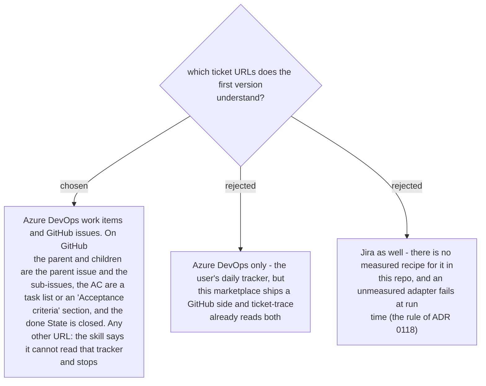

# resolve-the-ticket reads Azure DevOps and GitHub Issues, and refuses any other URL

Ruled 2026-11-16 by the user (Pon), taking the recommended option. The parent / child read
is the one part `ticket-trace`'s reference does not yet carry; the skill's own reference file
gives the worked commands for both trackers, and each is measured against a real ticket
before it is written down.
