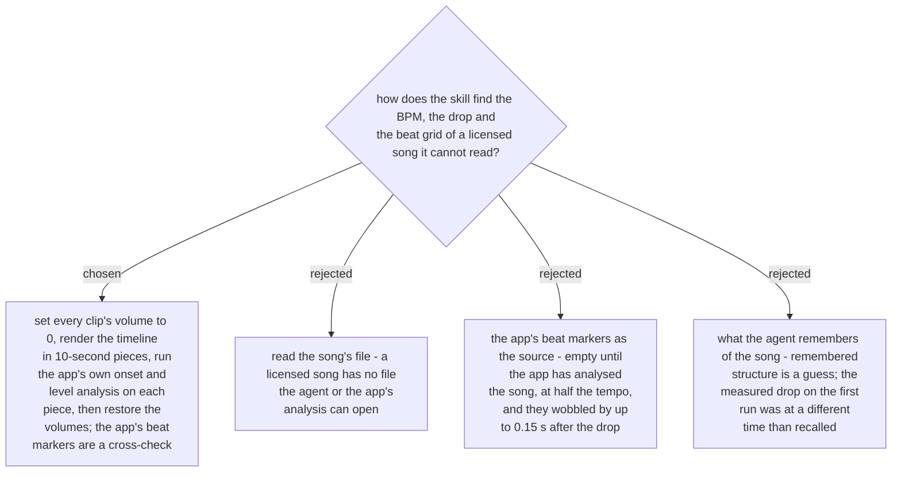

# A licensed song is measured from a timeline render

> **Amended by
> [ADR 0313](workflow-daily-work-0313-the-user-adds-the-song-by-hand-and-no-timeline-is-ever-emptied.md)
> (2026-11-08):** the measurement stands, but the song is added by the user by hand (a song
> added through the tools rendered silent), and a render with no audio track stops the run.

Measured on 2026-11-07. `audioLevels` and `audioOnsets` on the music element answered "no
readable source file", and `previewVideo` with the song's alias failed. What worked: render
the timeline (`previewVideo` with `includeClip`), then pass the render's path to
`audioOnsets` / `audioLevels`. The app can read its own temporary file even though the shell
cannot. With the clips at their normal volume the clips' sound blurred the result, so every
clip is set to volume 0 first and restored afterwards. The drop shows as a short dip
followed by a loud hit.

`beatMarkers` came back empty for one song queried right after it was added, and full for
another queried minutes later (366 beats, `estimatedBpm` 62.5 for a song measured at 126
BPM, one marker every two beats, spacing 0.94-0.98 s but 1.06-1.10 s for six markers after
the drop). So the skill reads them after the measurement, as a cross-check of the BPM
(doubling a half-tempo estimate), never as the source of the grid or the drop. The same
renders check the finished cut: every cut in the fast part must fall within two frames of
a measured onset where the music has one (spec §4, Phase 6). Agreed by the user in the recap
on 2026-11-07; the beat-marker evidence was added at spec review the same day.
