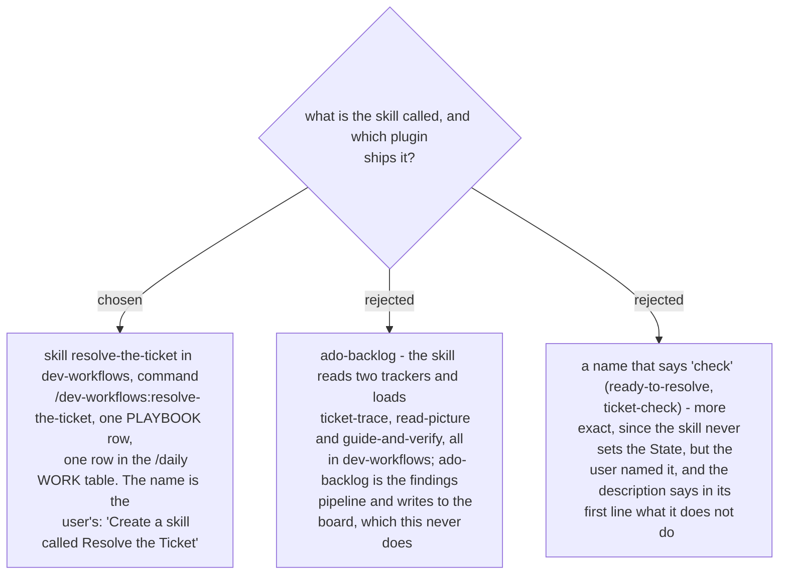

# resolve-the-ticket lives in dev-workflows, under the user's own name

Decided 2026-11-16 in the grilling session; the name is the user's (Pon), the placement is
the agent's, following where the skills it loads already live. Two collisions are closed in
the description and the glossary, not by renaming: `work-map` *resolves* a **Decision
ticket** (a different thing, a different plugin), and "resolve" here never means the skill
changes the State (ADR 0295).
