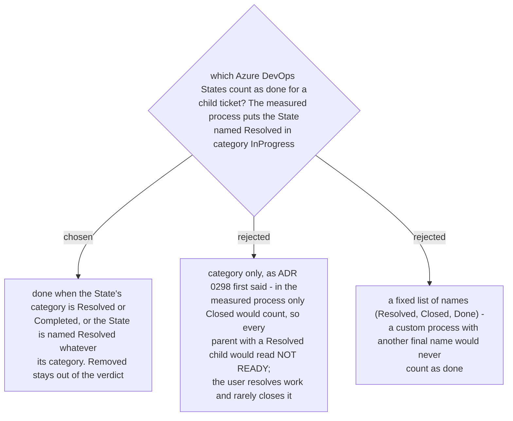

# A child is done at a Resolved or Completed category, or at a State named Resolved

Ruled 2026-11-16 by the controller during execution of the resolve-the-ticket plan, after
Task 1 measured the State categories of type User Story in MackayGoodwin/Elevate: New ->
Proposed, Active -> InProgress, Resolved -> InProgress, Closed -> Completed, Removed ->
Removed. The name `Resolved` is added because it is the State this skill gates: a child that
was itself set to Resolved has passed the same check the parent is about to pass. Amends the
done rule of ADR 0298, which stays in force otherwise. GitHub is unchanged: `closed` is done.
