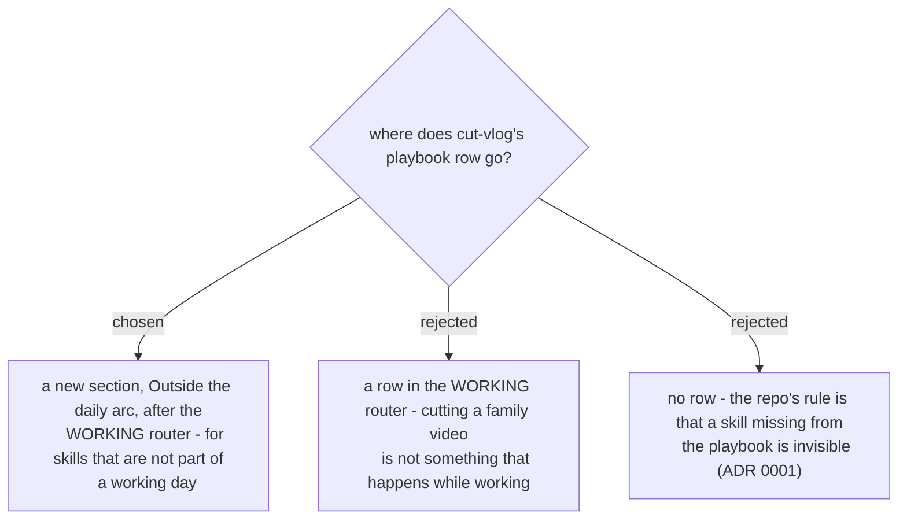

# The playbook gets an "outside the daily arc" section

Every new skill adds a playbook row in the same commit (ADR 0001). cut-vlog is the first
skill that has no place in the daily circle, so it gets its own section rather than
stretching the WORKING router. Agreed by the user in the recap on 2026-11-07.
