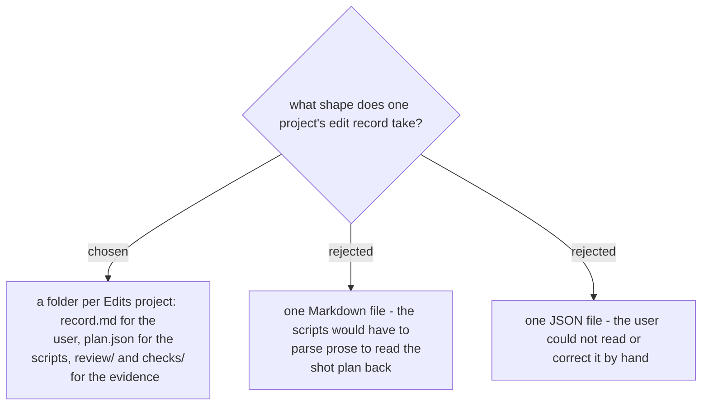

# The edit record is a folder per project

The record (ADR 0297) has two readers. The user reads what was decided and corrects it; the
scripts (ADR 0298) read the shot plan and compare it with the timeline. A folder per project
serves both: `record.md` is the human summary (song, BPM, drop, exports, corrections),
`plan.json` is the only file `plan_cuts.py` and `compare_timeline.py` read, `review/` holds
the contact sheets and capture times, and `checks/` holds each step's second-channel check
(ADR 0296). The folder is named by the Edits project id, so a renamed project keeps its
record. Decided in the spec (§12-a) and approved by the user on 2026-11-07.
