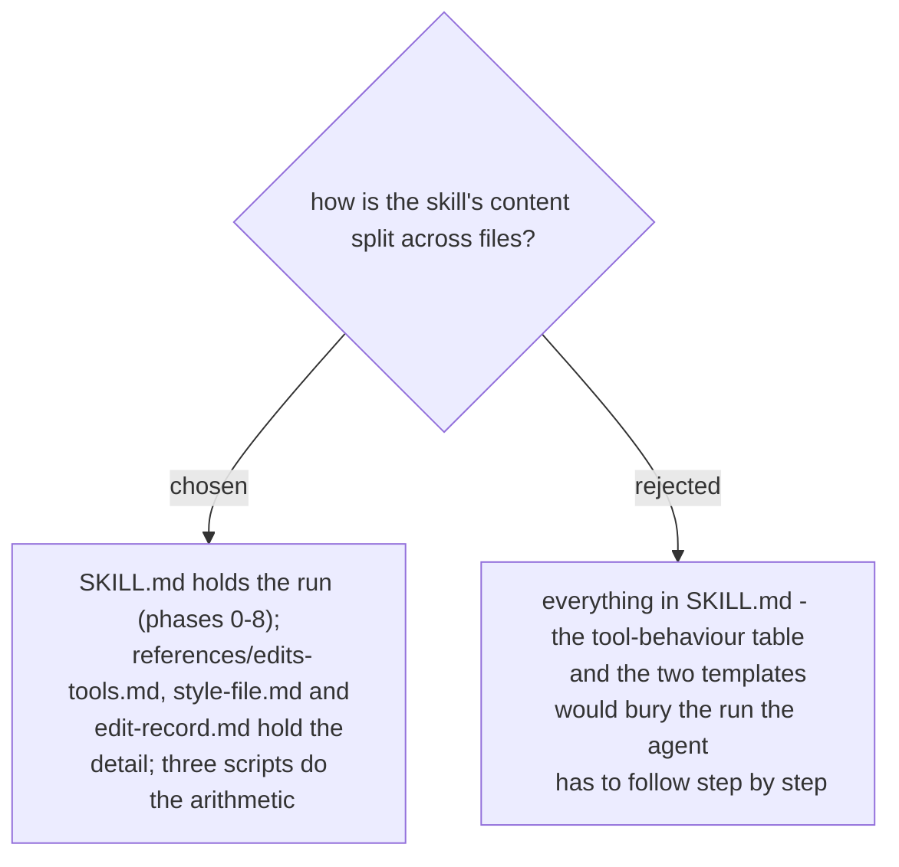

# cut-vlog is one skill file, three references and three scripts

The run is what the agent must not lose its place in, so `SKILL.md` carries only the phases
and points to a reference at the phase that needs it. The Edits tool behaviours (spec §7)
change when the app changes, so they live in one file that can be corrected alone. The
style-file and edit-record templates are read once per run. The three scripts are the ones
ADR 0298 chose: `review_footage.py`, `plan_cuts.py`, `compare_timeline.py`. Decided in the
spec (§12-b) and approved by the user on 2026-11-07.
