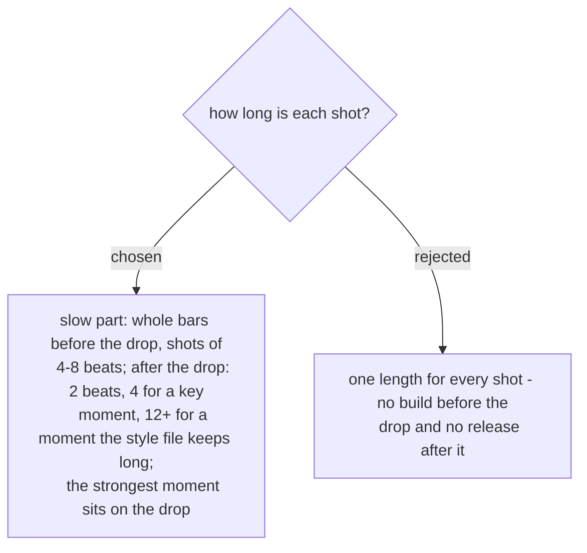

# The cut follows a build-and-release rhythm

A slow-build song (ADR 0294) has two halves, and the cut follows them. Before the drop the
shots are long and land on bar lines, so the viewer settles in. On the drop the strongest
moment of the day starts on the hit, and after it the shots shorten to two beats so the cut
moves with the music. A moment the style file marks as one to keep long breaks that rule on
purpose and runs 12 beats or more. `plan_cuts.py` turns these lengths into frame-exact
times; the beat comes from the measured BPM (ADR 0306). Decided in the spec (§12-c) and
approved by the user on 2026-11-07.
