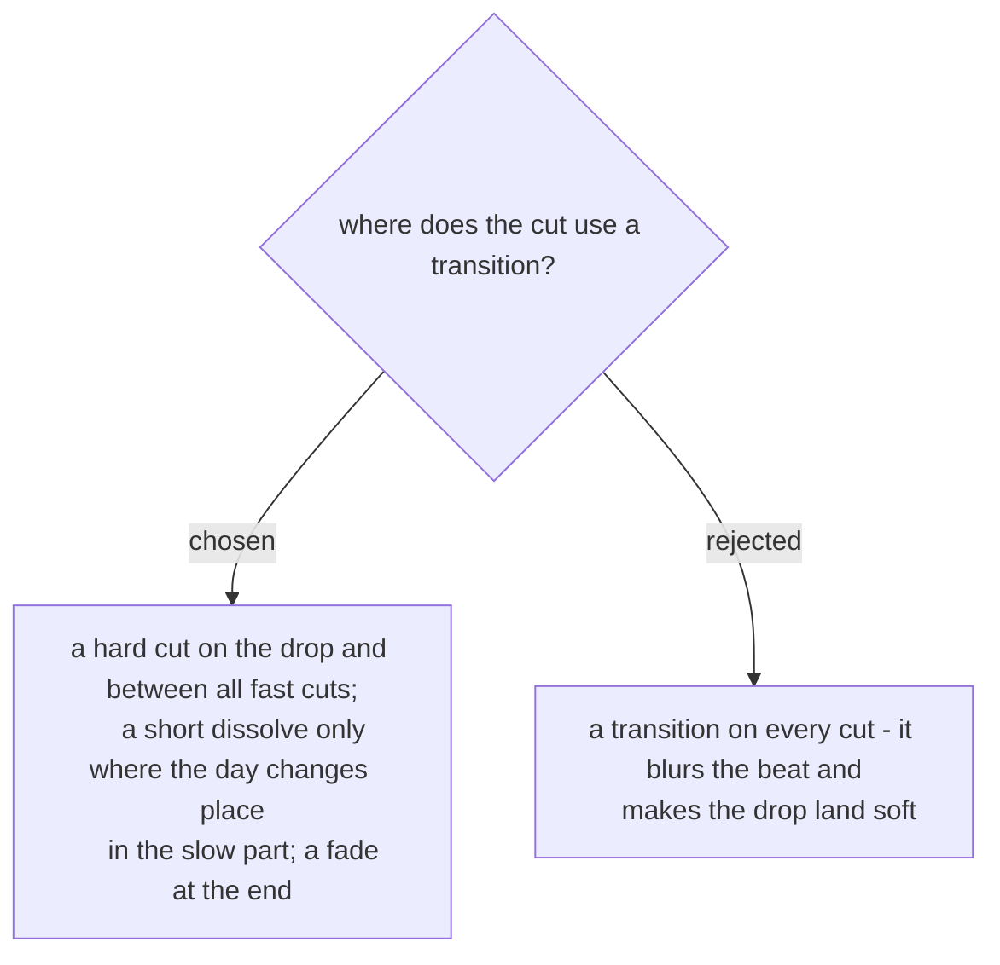

# Hard cuts by default, a dissolve only where the place changes

The first run (2026-11-07) showed that a transition on a fast cut hides the beat the cut was
placed on, and a dissolve into the drop takes the hit away. A dissolve is kept for one job:
telling the viewer the day has moved to a new place, which only happens in the slow part.
The video ends on a fade so it does not stop on a cut. Decided in the spec (§12-d) and
approved by the user on 2026-11-07.
