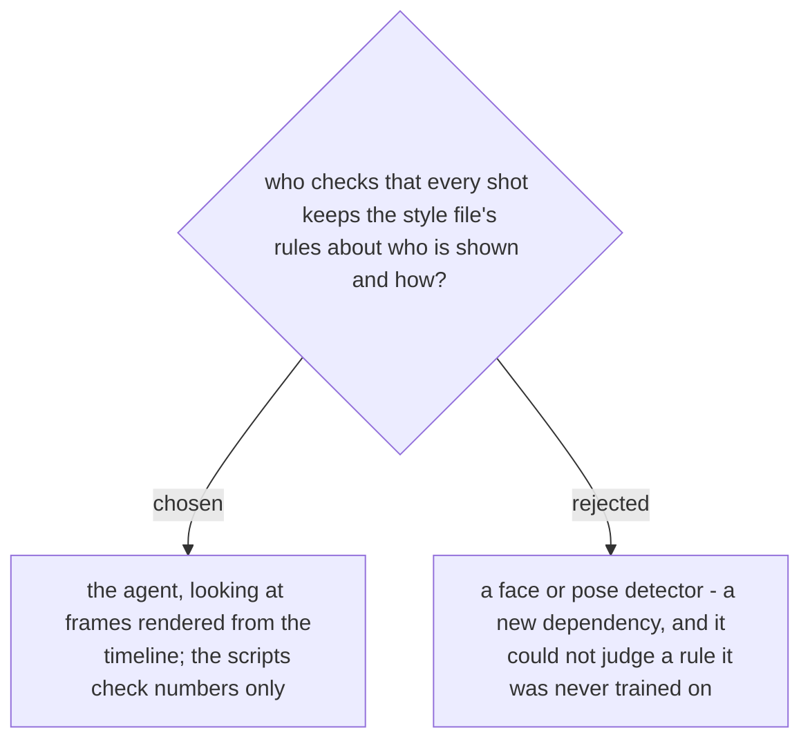

# The style rules are judged by the agent on rendered frames

Who is shown and how is a visual judgment that changes with each user's rules. A detector
would need a new install on the user's Mac, and it could not judge a rule it was never
trained on, such as "no close-ups of the people in the background". The agent already looks at the
contact sheets in the review (Phase 2) and at frames captured from the timeline before
export (Phase 6), so it judges the rules there and records each finding in `checks/`. The
scripts stay arithmetic: times, beats and the plan-to-timeline comparison. Decided in the
spec (§12-e) and approved by the user on 2026-11-07.
