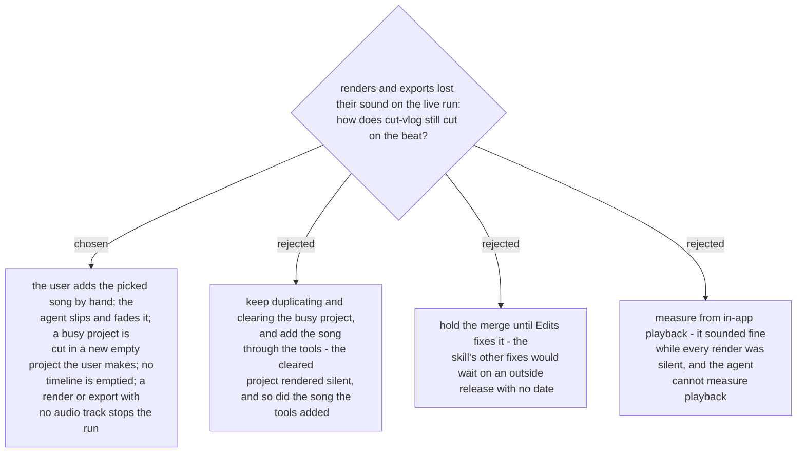

# The user adds the song by hand, and no timeline is ever emptied

- **Status:** Accepted. Supersedes in part
  [ADR 0301](workflow-daily-work-0301-a-project-with-work-on-its-timeline-is-duplicated-first.md)
  (a busy project is no longer duplicated and cleared) and amends
  [ADR 0306](workflow-daily-work-0306-a-licensed-song-is-measured-from-a-timeline-render.md)
  (the song being measured is added by the user, not by the agent).
- **Date:** 2026-11-08

On the live run of 2026-11-08 (Edits' own sample project, worked in a copy), media placed
through the MCP tools — whole clips with `addMediaPanelItemsToTimeline`, a licensed song
with `addSongToComposition` — rendered with no audio track in `previewVideo` and in
`export`, while `getAudioState` said audible. A project whose every element had been
deleted once rendered no audio afterwards even for a song added by hand, and reopening did
not help; in a copy where that deletion was undone, a hand-added song rendered and
`audioOnsets` measured its tempo. In-app playback still sounded fine.

So the skill works around what was measured. After the pick, the user adds the song by
hand at 0:00, and the agent reads its element (`content` `music`), slips it, and fades it.
When the named project's timeline has elements and no record exists, the user makes a new
empty project `<project> – cut-vlog` with the same footage; a duplicate is allowed only if
its timeline is never cleared. Clips are deleted one at a time and never the song; the
planned clips are added before Phase 3's clips are removed, because deleting the last video
clip also deletes the music. A render whose analysis answers "the file has no audio track",
or an export `ffprobe` shows without an audio stream, stops the run instead of being
measured or delivered. The clips' own sound is lost until Edits fixes MCP-added audio,
which is acceptable when the style keeps clip sound low under the music. The new-project
path and the add-then-delete order of the clips are workarounds reasoned from these
measurements, not yet run live (2026-11-08); the next live run must confirm them.

The behaviour is written down as a dated known issue in
`plugins/media-workflows/skills/cut-vlog/references/edits-tools.md` and re-checked after
every Edits update. Decided by the owner on 2026-11-08: fix the skill, merge with the known
issue documented, and repeat the live run after the next Edits update.
