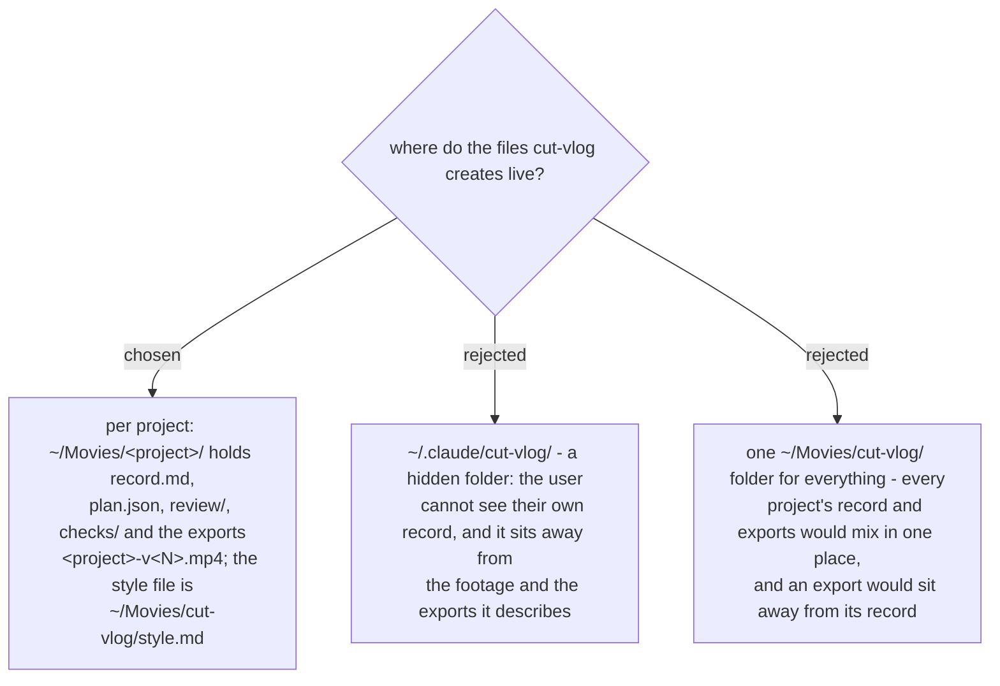

# cut-vlog keeps its files in the video-editing folder

- **Status:** Accepted. Amends
  [ADR 0297](workflow-daily-work-0297-one-edit-record-per-project-in-the-users-folder.md)
  (the record is no longer beside the style file in `~/.claude/`),
  [ADR 0304](workflow-daily-work-0304-every-export-is-a-new-numbered-file.md)
  (exports go inside the project folder),
  [ADR 0308](workflow-daily-work-0308-the-edit-record-is-a-folder-per-project.md)
  (the folder is named by the project's name, not its id) and
  [ADR 0299](workflow-daily-work-0299-the-plugin-is-media-workflows-the-skill-is-cut-vlog.md)
  (the user folder is no longer `~/.claude/cut-vlog/`). ADR 0291 stands: `~/Movies/` is
  still outside the repo.
- **Date:** 2026-11-08

The skill used to keep the style file and every record under `~/.claude/cut-vlog/`, a
hidden folder, while the footage and the exports were in `~/Movies/`. The user could not
open their own record without looking for it, and the record was far from the video it
described. Decided by the owner on 2026-11-08: everything the skill creates goes in the
video-editing folder.

Each project has `~/Movies/<project>/`, where `<project>` is the Edits project's name as
worked in (the `<name> – cut-vlog` copy's name when one was made). It holds `record.md`,
`plan.json`, `review/`, `checks/` and the exports `<project>-v<N>.mp4`, N one more than the
highest in that folder, never over an earlier file. The style file is
`~/Movies/cut-vlog/style.md`, which Phase 1 creates when it is missing.

A folder named by the project's name no longer survives a rename by itself, so the Edits
project id is stored inside `plan.json` (`project_id`) and in `record.md`. A resume looks
for `~/Movies/<project>/` first, then for the `<project> – cut-vlog` folder; it finds a
renamed project's old folder by scanning `~/Movies/*/plan.json` for the stored id; and when
a folder exists but its stored id differs from the opened project's, it asks the user
before reusing it. A one-time migration moves an old `~/.claude/cut-vlog/style.md` and an
old `~/.claude/cut-vlog/projects/<id>/` folder to the new places and tells the user.
