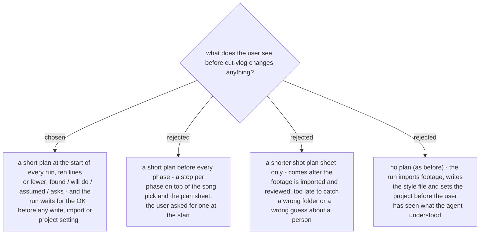

# cut-vlog shows a short plan at the start of every run

- **Status:** Accepted. Amends
  [ADR 0300](workflow-daily-work-0300-cut-vlog-is-measured-by-script-tests-four-evals-and-one-live-run.md)
  (a fifth eval, `short-plan-before-any-change`, joins the four) and the **Shot plan sheet**
  entry in `CONTEXT.md` (the sheet is now the third stop, after the short plan and the song pick).
- **Date:** 2026-11-12

On the live run of 2026-11-12 the request named the footage only as "a separate folder"
and set a rule about a person by a family word. The skill imported footage, wrote the style
file and set the project before the user had seen what it understood; the user then
corrected a guess about a name mid-run. Decided by the owner on 2026-11-12: every run starts
with a short plan the user OKs.

After Phase 0 and the read-only parts of Phase 1 (style file, project, record folder,
footage), the skill shows ten lines or fewer under four heads: **found** (project, footage,
style file, record folder and resume point), **will do** (the phases this run takes and
where it waits for the user), **assumed** (each guess read from the request), **asks** (the
style questions still open - Phase 1's one round of questions now rides here). It waits for
the OK; a correction changes the short plan and shows it again. A correction run (Phase 8)
shows one too: the rows it will change and the version it will export.
