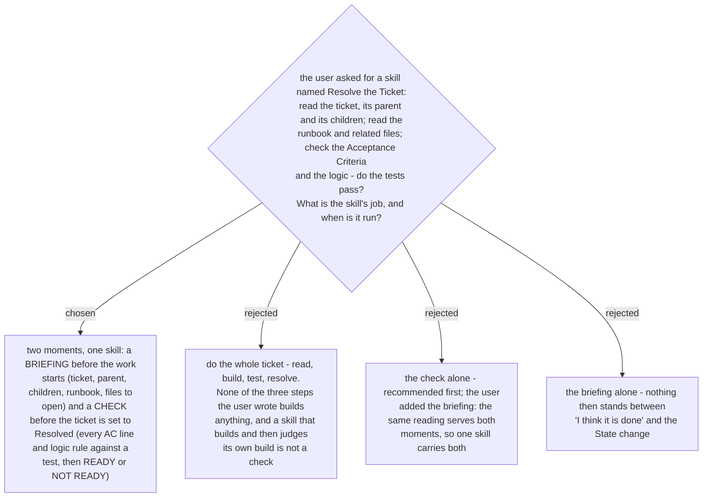

# resolve-the-ticket briefs before the work and checks before the resolve, and builds nothing

> **Amended 2026-11-18 by ADR 0339.** The skill still builds nothing itself, but it no longer "never starts the skill it names": it offers the skill and loads it on the person's yes. It now has four stages, not two moments (ADR 0337).

Ruled 2026-11-16 by the user (Pon). Offered three readings of "resolve" - A check before
resolving, B do the whole ticket, C brief me before I start - the user first took A, then
said "let go with c and a". The skill therefore has two moments and never builds or fixes:
the work between the briefing and the check belongs to the other skills of the arc. The
stake was shown with a real case from the user's project: #154 was Resolved and reopened on
2026-11-16 because a rule ("I don't agree" must not be read as consent) had no passing test
at the moment the State changed.
