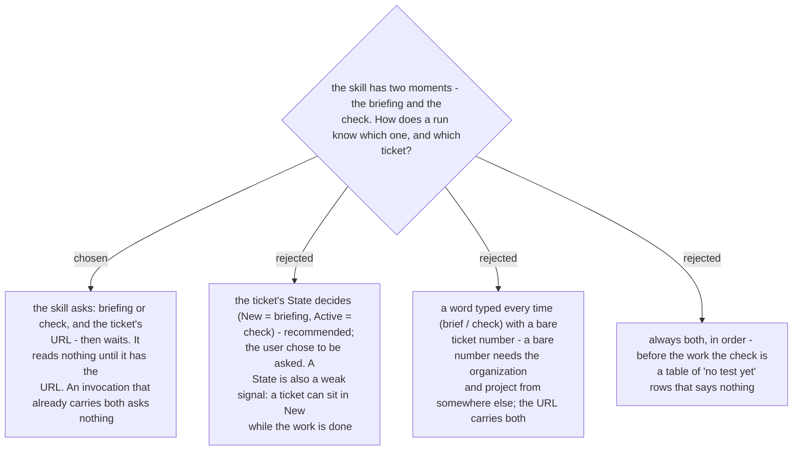

# resolve-the-ticket asks which moment and waits for the ticket URL

> **Amended 2026-11-18 by ADR 0337.** The skill still waits for the ticket's URL. It no longer asks "briefing or check": it reads the files, proposes the stage and asks for a yes.

Ruled 2026-11-16 by the user (Pon): "ask me and wait for url". The ticket is named by its
URL, not by a bare number, because the URL names the tracker, the organization and the
project in one string (`dev.azure.com/<org>/<project>/_workitems/edit/<id>`), so the skill
needs no `AZDO_ORG` / `AZDO_PROJECT` and cannot read the right number in the wrong project.
Reading "ask me" as *ask which moment* is the agent's interpretation; the user confirmed
the URL wait in their own words.
