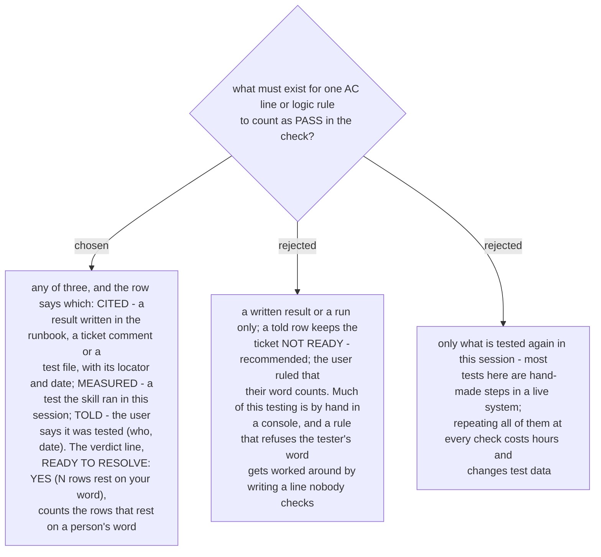

# A row passes on a written result, a test run now, or the user's word - each marked

Ruled 2026-11-16 by the user (Pon): "Your word counts too". The three marks are
`why-this-logic`'s **Proof mark** words with the same meanings (ADRs 0263, 0266, 0272), so
no new vocabulary is added. What keeps a told pass honest is that it is never shown as
anything else: the row carries `told: <who>, <date>`, the verdict reads
`READY TO RESOLVE: YES (N rows rest on your word)`, and the drafted closing comment carries the same mark.
