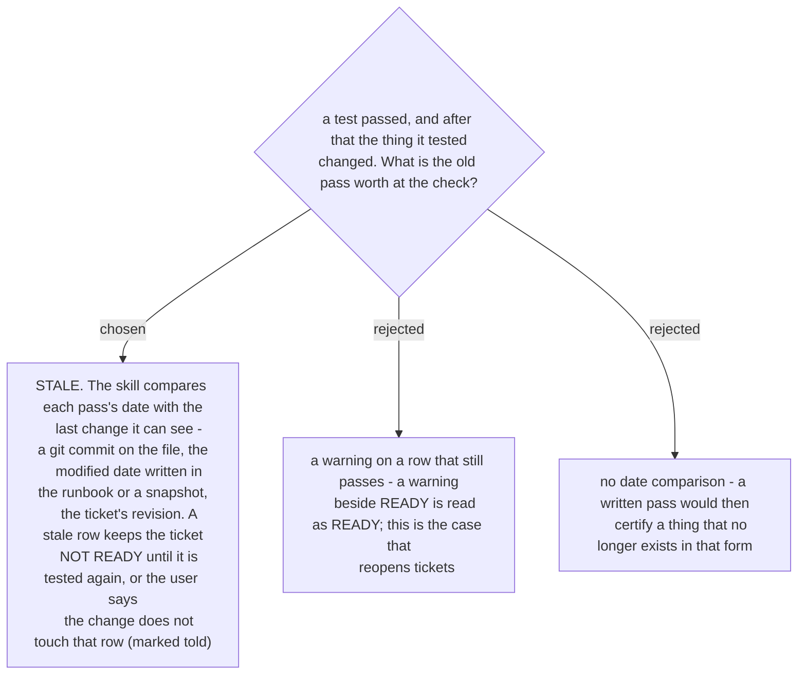

# A pass older than the last change is stale and keeps the ticket not ready

Ruled 2026-11-16 by the user (Pon), taking the recommended option. The row shows both dates
(`passed 2026-11-10; changed 2026-11-12`) so the person can judge it. A pass with no date
cannot be compared: it is shown as `pass (no date)` and counted in the verdict line with the
told rows. The skill compares against what the documents and git already show; a change date
that only the live system holds is read by one read-only query, asked for per query and per
run, in `why-this-logic`'s shape (ADR 0275) - that part is the agent's reading of "the last
change it can see", not the user's words.

Amended by ADR 0331: the ticket counts as a change only through an edit to its requirement text.
