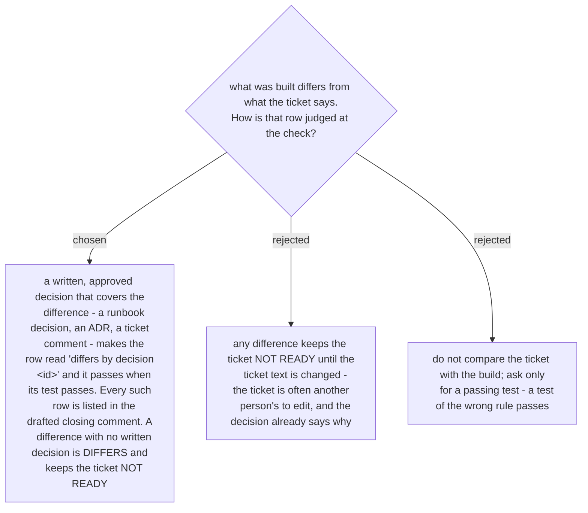

# A difference from the ticket passes only under a written decision

Ruled 2026-11-16 by the user (Pon), taking the recommended option. Real case used: #151's
ticket gives the 7-day cut-off as a UTC day; runbook decision D2, approved 2026-11-09, built
it on the Melbourne date following the Tech Spec. The comparison itself uses
`why-this-logic`'s verdict words - a row that *contradicts* its source with no decision is
this ADR's DIFFERS. A decision counts only when it is written and says who approved it; the
user's word given during the check closes the row as told, the same as ADR 0319.
