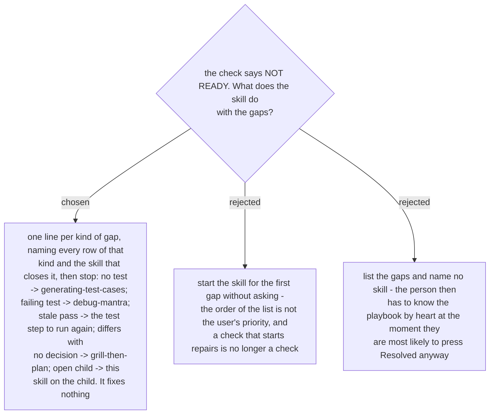

# On NOT READY the skill names the next skill per kind of gap, and stops

> **Amended 2026-11-18 by ADR 0339.** After NOT READY the skill now offers the skill for each gap and loads it on the person's yes.

Ruled 2026-11-16 by the user (Pon), taking the recommended option. The shape is
`why-this-logic`'s closing offer (at most one line per kind, every ID of that kind named).
The skill never invokes the named skill itself; the user does.
