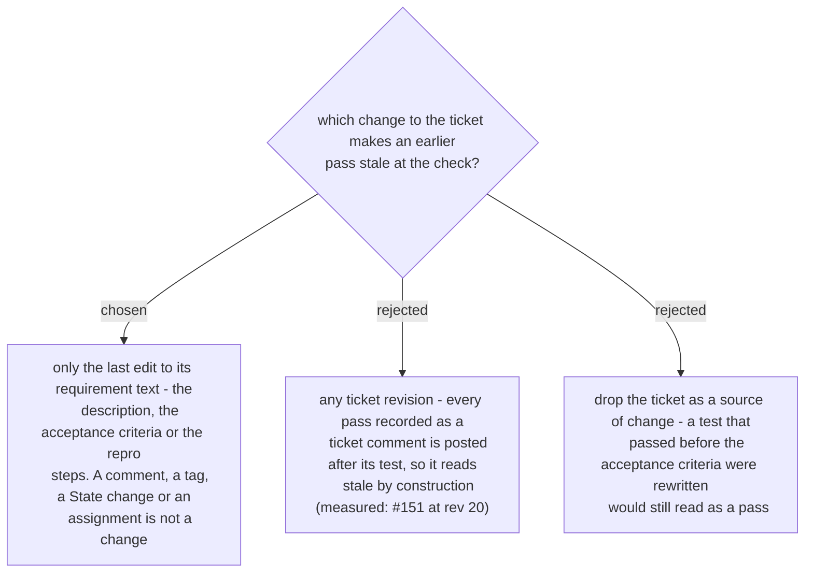

# The ticket makes a pass stale only through an edit to its requirement text

Ruled 2026-11-16 by the controller during execution of the resolve-the-ticket plan, after
the final whole-branch review. Amends ADR 0320, whose list of change sources named "the
ticket's revision": the git commit on the file and the modified date written in a runbook or
a snapshot stay as they were, and the ask-per-query rule for a date only the live system
holds is unchanged.

Evidence, measured read-only on 2026-11-16: Azure DevOps #151 in MackayGoodwin/Elevate is
at rev 20 after 25 updates, and only three of them touch the requirement text - rev 1, rev 6
(acceptance criteria and description, 2026-10-30) and rev 13 (description,
2026-11-10T03:26:10Z). Revs 14-20 changed only the State (revs 14, 18, 20), the stack rank
(revs 15, 19) and the comments (revs 16 and 17 add `System.History`, 03:40Z and 03:41Z) - a
comment is itself a revision, so a pass written up as a comment moves the revision past its
own test, and the next State change moves it again. The date of each edit is `System.ChangedDate`, not the update's `revisedDate`,
which marks when the next revision replaced it. On GitHub the body's `lastEditedAt` is the
edit date, and `createdAt` when the body was never edited. The commands are in the skill's
`references/ticket-family.md`.
