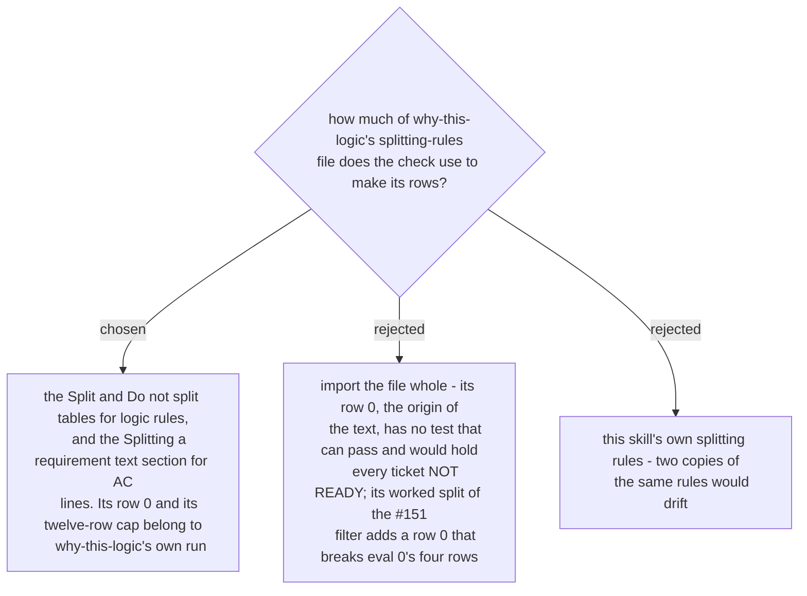

# Only why-this-logic's split tables apply - not its row 0 and not its twelve-row cap

Ruled 2026-11-16 by the controller during Task 2's review, in the execution of the
resolve-the-ticket plan; written as an ADR after the final whole-branch review found the
exclusion had none. The rule is carried in the skill's step 4.1 and in the spec's section
7.1.

Evidence: why-this-logic's `references/splitting-rules.md` says under *Always* that row 0
is the origin of the text itself - a row that a source trace answers and a test never does -
and that a run is capped at the rows the user pointed at, asking which part to trace first
when there are more than about twelve. Its *Worked split - Elevate #151* shows the filter as
row 0, row 1 (the term) and row 2 (the codes). Neither rule fits a check whose rows each
need a passing test and whose ticket may carry more than twelve rules. The split tables
themselves are what this skill needs, so it loads them and nothing else rather than
restating them.
