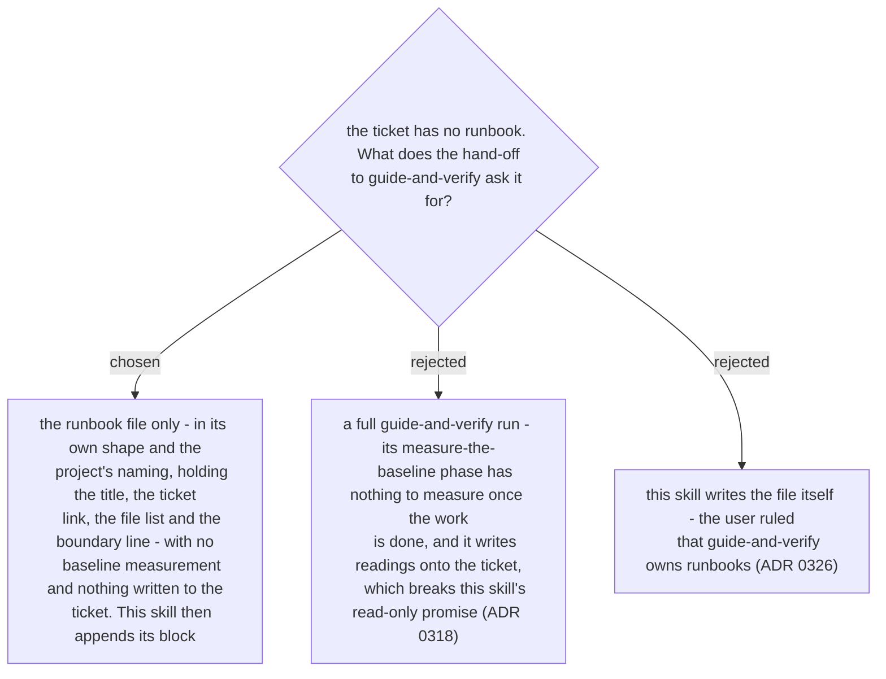

# The no-runbook hand-off asks guide-and-verify for the file, not for a runbook session

> **Narrowed 2026-11-18 by ADR 0341.** The file-only hand-off now applies in one case: the check is asked for on a ticket whose work was done with no runbook. In the do-and-verify stage guide-and-verify runs in full and creates the runbook.

Ruled 2026-11-16 by the controller during execution of the resolve-the-ticket plan, after
the final whole-branch review. Amends ADR 0326, which stays in force otherwise: the runbook
still comes from `guide-and-verify`, in its shape and the project's naming, and this skill
still never authors one.

Evidence: the review found that ADR 0326's hand-off, read as "run guide-and-verify",
starts a session whose first phase measures the system before a change. At the check the
change is already made, so that baseline would record the after state as the before state,
and the session posts its readings on the ticket - a tracker write this skill promises never
to make. Asking for the file alone keeps both promises and gives the check block a home.
