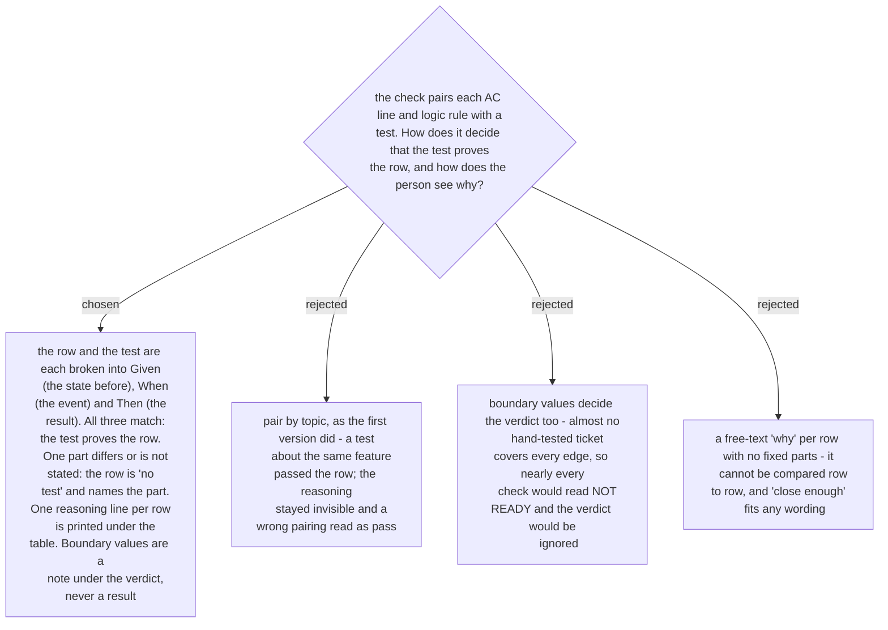

# A test proves a row only when its Given, When and Then all match

Ruled 2026-11-16 by the user (Pon), after asking whether the skill lacked a step-by-step way
of thinking and which method software engineers use. Given-When-Then is the behaviour-driven
development form (Specification by Example); the table of rows against tests is the
requirements traceability matrix the skill already had; boundary value analysis is the
note. The motivating case is the one behind the skill: #154 was resolved with a consent
test that passed and reopened because "I don't agree" was read as consent - the test's
*When* was not the rule's *When*. Reading that test as answering a plain "no" is the
agent's illustration, not a measured fact. Adds a step to the order of ADR 0319's check;
a told row gets the same three questions.
