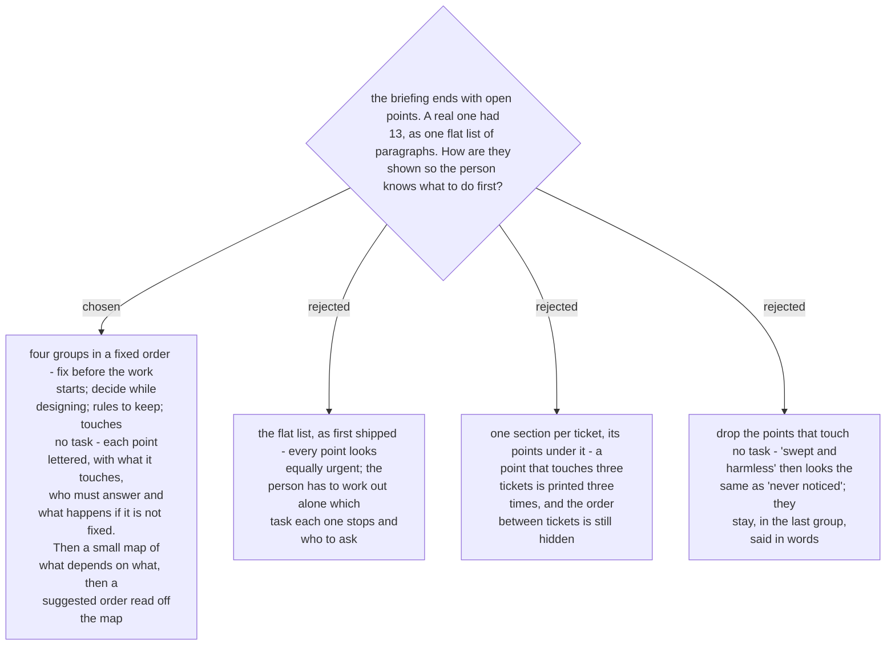

# The briefing's open points are sorted by what they do to the work

Ruled 2026-11-18 by the user (Pon). A briefing on Feature #193 and its stories #194-#197
returned 13 open points as paragraphs; the user said "open point มันอ่านยากอ่ะ" and asked to
see the effect on each task, which points affect nothing, what to fix first, and what
depends on what. The agent re-cut those 13 points into the four groups, a dependency map and
an order; the user approved that shape ("ok you can modify skill"). The briefing stays
read-only and builds nothing (ADR 0316): the order is a suggestion, and a person who must
answer is named only when a file names them - otherwise `not named`.
