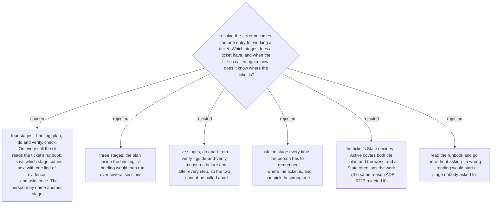

# resolve-the-ticket walks four stages and reads the runbook to know which comes next

Ruled 2026-11-18 by the user (Pon), on Decision ticket `stage-model` of the map
`docs/decision-map/one-entry-for-a-ticket/`. Both answers were the user's pick from options
the agent laid out: "4 ช่วงตามตาราง" and "A. อ่าน runbook แล้วเสนอ".

| stage | what happens | ends when |
|---|---|---|
| 1. briefing | the ticket, its family and its files are read; the open points are shown | the person has read it and says go on |
| 2. plan | the open design points are decided, on a Decision map | no open point is left to decide |
| 3. do and verify | the work is done step by step and each step is measured | every step in the runbook has a recorded result |
| 4. check | one row per AC line, logic rule and child - READY or NOT READY | READY, and the person resolves the ticket |

The plan stage is skipped when there is nothing to decide; *when* that is belongs to ticket
`map-trigger`. Where progress inside a stage is written belongs to `resume-after-break`.

This amends [ADR 0317](workflow-daily-work-0317-resolve-the-ticket-asks-which-moment-and-waits-for-the-ticket-url.md):
the skill still waits for the ticket's URL, but it no longer asks "briefing or check" - it
proposes the stage and asks for a yes. For the proposal to work, each stage must leave a
trace in the runbook; the briefing leaves none today, so it gains one line there. Only
resolve-the-ticket's own text changes for this ([ADR 0338](workflow-daily-work-0338-the-one-entry-is-built-by-changing-resolve-the-ticket-only.md)).

**In the skill since dev-workflows 0.66.0** (`plugins/dev-workflows/skills/resolve-the-ticket/SKILL.md`).
