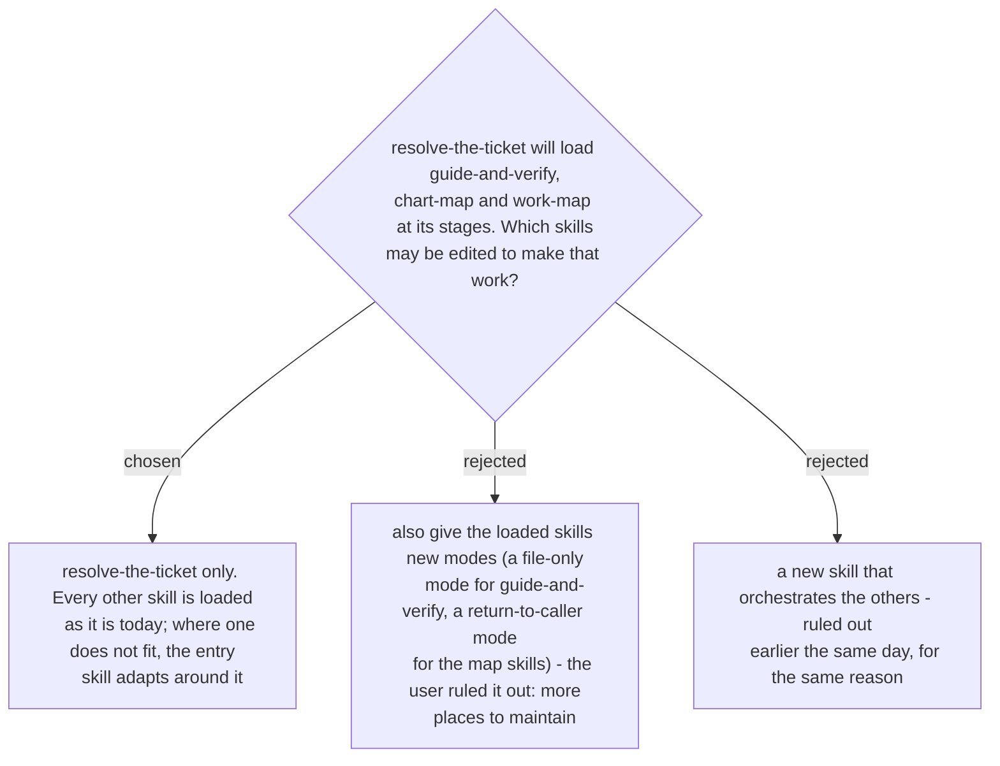

# The one entry is built by changing resolve-the-ticket only

Ruled 2026-11-18 by the user (Pon), while Decision ticket `stage-model` of the map
`docs/decision-map/one-entry-for-a-ticket/` was being grilled: "ต้องไม่แก้สกิลเก่านะ", then,
asked which skills that covers, "ห้ามแก้ทุกสกิล ยกเว้น resolve ticket".

What follows for the open tickets of that map:

- `gav-contract` - guide-and-verify gets no file-only mode. The check reads what
  guide-and-verify already writes, or resolve-the-ticket asks for it another way.
  [ADR 0333](workflow-daily-work-0333-the-no-runbook-hand-off-asks-guide-and-verify-for-the-file-not-for-a-runbook-session.md)
  leans on such a mode and has to be looked at again there.
- `one-session-stop` - chart-map and work-map keep their "one session, then stop" as it is.
  The entry skill ends its own run at those stops.
- `plugin-missing`, `code-work-stage` - any fallback or stage rule is written in
  resolve-the-ticket.
