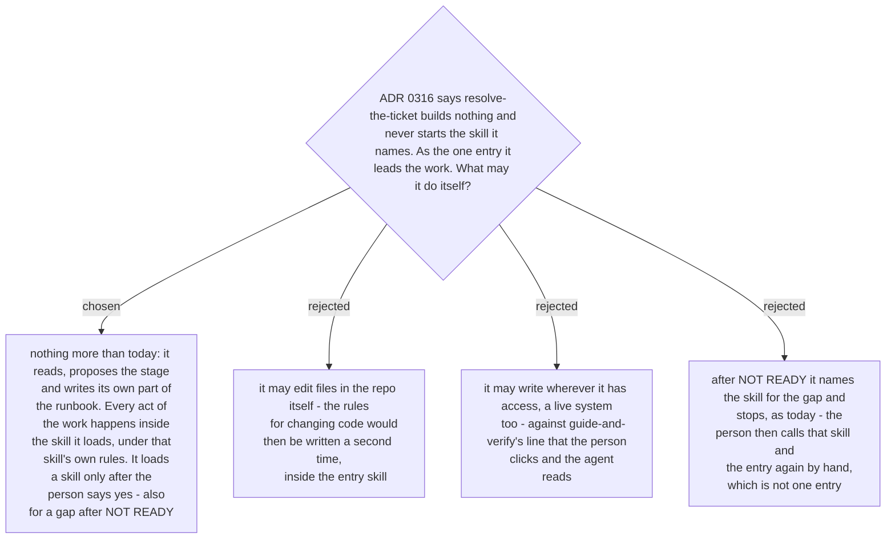

# resolve-the-ticket leads the work but acts only through the skill it loads

Ruled 2026-11-18 by the user (Pon), on Decision ticket `acting-rule` of the map
`docs/decision-map/one-entry-for-a-ticket/`. Both answers were the user's pick from options
the agent laid out: "A. ไม่ลงมือเอง" and, for the gap after NOT READY, "1. เสนอ แล้วโหลดเมื่อตอบใช่".

What stays a person's alone:

| act | whose | rule |
|---|---|---|
| a comment, the State, a ticked AC on the tracker | the person | ADR 0318, unchanged |
| a change in a live system | as `guide-and-verify` says when it is loaded: the person clicks, or hands back one step | that skill's text, unchanged (ADR 0338) |
| a change in the repo | the loaded skill, under its own rules | which skill that is for code-only work is ticket `code-work-stage` |

This amends [ADR 0316](workflow-daily-work-0316-resolve-the-ticket-briefs-before-the-work-and-checks-before-the-resolve-and-builds-nothing.md)
in one place only: "never starts the skill it names" becomes "offers the skill and loads it
on a yes". "Builds nothing and fixes nothing" still holds for the entry skill itself.

**In the skill since dev-workflows 0.66.0** (`plugins/dev-workflows/skills/resolve-the-ticket/SKILL.md`).
