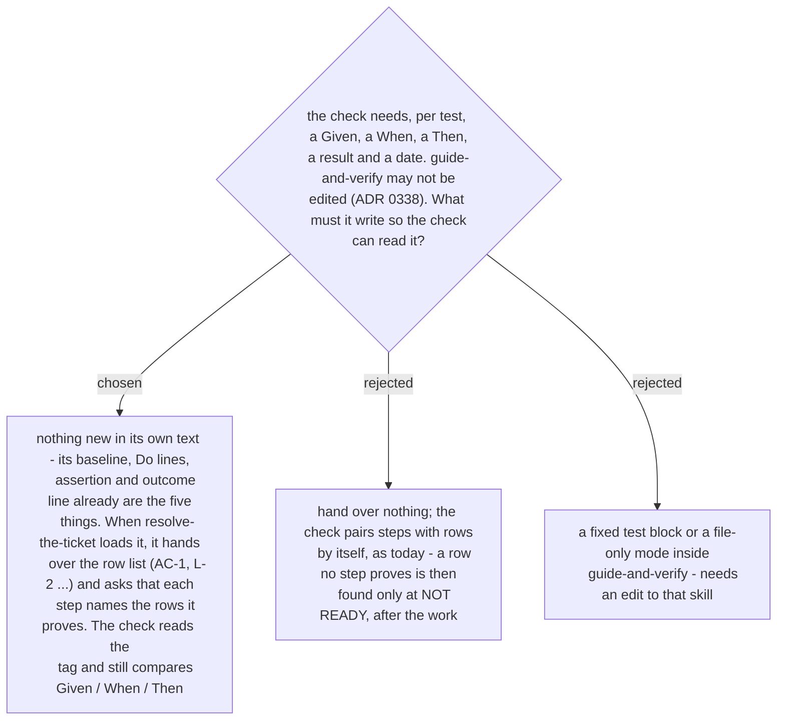

# The do stage hands guide-and-verify the row list and asks each step to name its rows

Ruled 2026-11-18 by the user (Pon), on Decision ticket `gav-contract` of the map
`docs/decision-map/one-entry-for-a-ticket/`: "A. ส่งรายการแถวไปด้วย", from two options the
agent laid out.

How the check reads a `guide-and-verify` step (its text as of 2026-11-18, read in the
working tree):

| the check needs | what guide-and-verify already writes |
|---|---|
| Given - the state before | the baseline, measured before the step (its phase 1) |
| When - the event | the step's **Do** lines (phase 3) |
| Then - the result that must be seen | the assertion declared before the person acts (phase 2) |
| result and date | the outcome line with its measurement and time (phase 5) |

The row tag is a request written in resolve-the-ticket, not a rule of `guide-and-verify`.
A step that carries no tag is paired the old way, by Given / When / Then alone
([ADR 0335](workflow-daily-work-0335-a-test-proves-a-row-only-when-its-given-when-and-then-all-match.md));
a tag never replaces that comparison.

**In the skill since dev-workflows 0.66.0** (`plugins/dev-workflows/skills/resolve-the-ticket/SKILL.md`).
