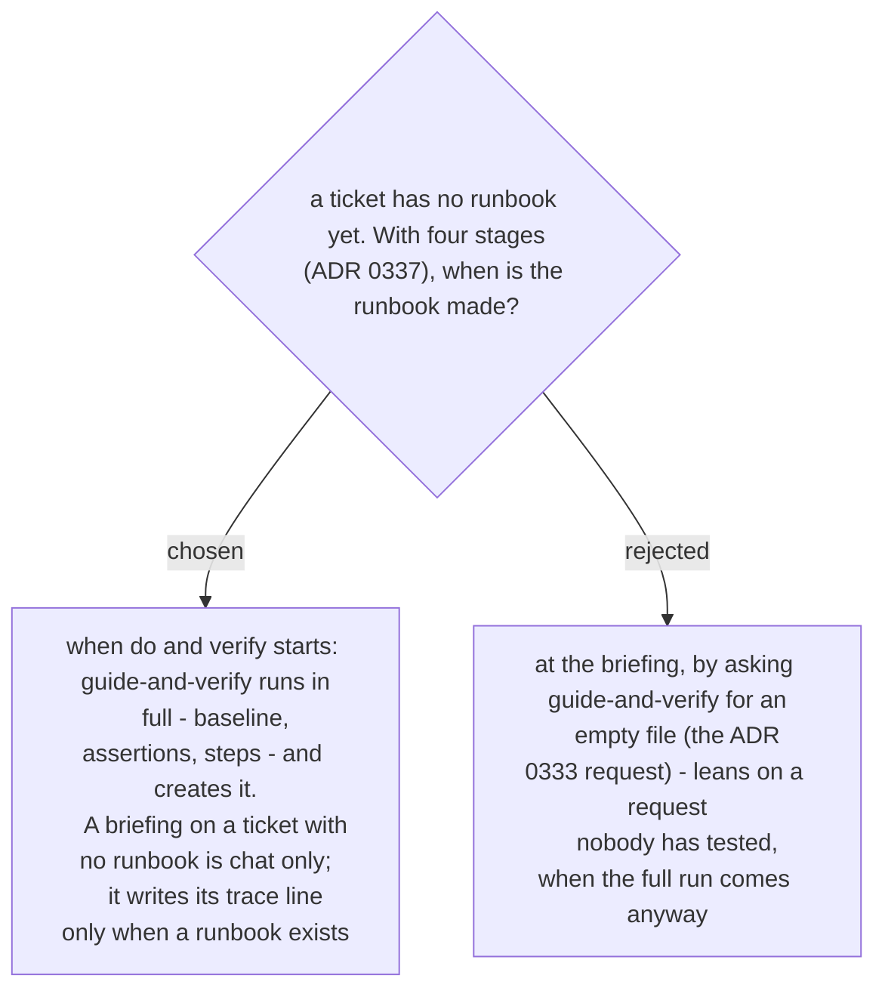

# A ticket with no runbook gets one when the do stage starts

Ruled 2026-11-18 by the user (Pon), on Decision ticket `gav-contract` of the map
`docs/decision-map/one-entry-for-a-ticket/`: "1. ตอนเริ่ม Do + verify", from two options the
agent laid out.

What this changes:

- [ADR 0337](workflow-daily-work-0337-resolve-the-ticket-walks-four-stages-and-reads-the-runbook-to-know-which-comes-next.md)
  said the briefing gains one line in the runbook. That holds only when a runbook exists.
  With none, a later call proposes the briefing again - it is read-only, so a second one
  costs nothing - or the person says "start the work".
- [ADR 0333](workflow-daily-work-0333-the-no-runbook-hand-off-asks-guide-and-verify-for-the-file-not-for-a-runbook-session.md)
  (ask for the file only) now covers one case: the person asks for the **check** on a
  ticket whose work was done without a runbook. Its reason still holds there - a baseline
  cannot be measured after the change.

One thing to know, not decided here: `guide-and-verify` records its readings on the ticket
as it goes. That is its own rule and stays (ADR 0338, ADR 0339); resolve-the-ticket itself
still writes nothing to the tracker (ADR 0318).

**In the skill since dev-workflows 0.66.0** (`plugins/dev-workflows/skills/resolve-the-ticket/SKILL.md`).
