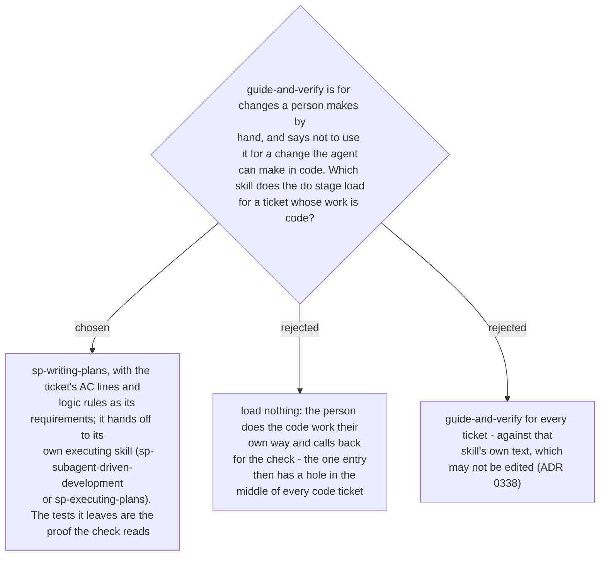

# For code work the do stage loads the plan-writing line

Ruled 2026-11-18 by the user (Pon), on Decision ticket `code-work-stage` of the map
`docs/decision-map/one-entry-for-a-ticket/`: "A. สายเขียนแผน", from three options the agent
laid out.

| the ticket's work | the do stage loads |
|---|---|
| a person must click in a console | `guide-and-verify` (ADRs 0340, 0341) |
| code the agent can write | `sp-writing-plans`, then the executing skill it hands off to |
| both | each part goes to its own skill |

The rest is the agent's reading of rules already made, not a separate answer from the user:

- **No before / after measurement is asked of code work.** The loaded skill acts under its
  own rules (ADR 0339); a test written first, failing before and passing after, is that
  line's measurement. The check takes a test file and its result as `cited` or `measured`
  already.
- **Which kind a ticket is** is proposed by the entry skill with the stage and confirmed by
  the person in the same question (ADR 0337).
- **The row list is handed over** here too, as it is to `guide-and-verify` (ADR 0340), so a
  task or a test can name the row it proves.

A one-line fix does not need the whole line: the person may name the check directly
(ADR 0337).

**Not yet in the skill.** It lands when the map's `do-and-verify` milestone is built.
