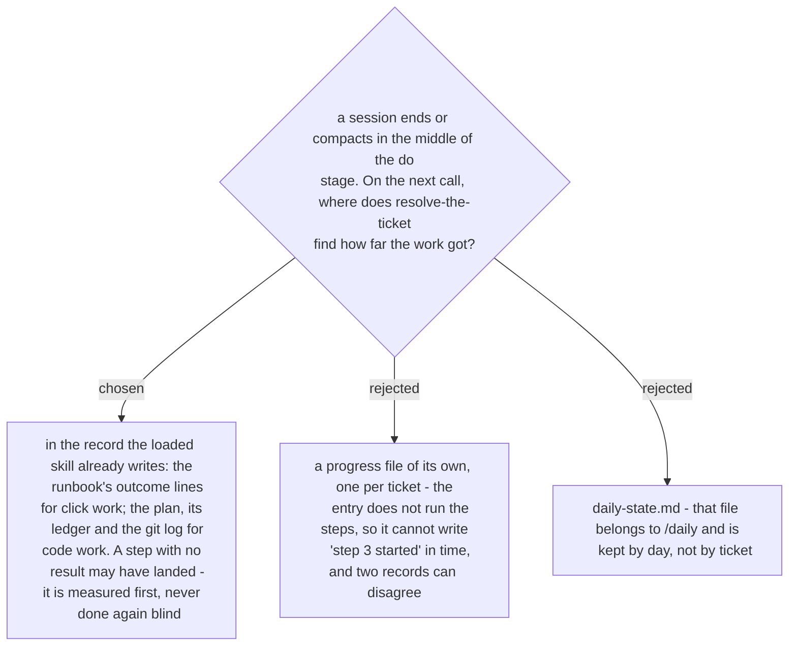

# After a break the entry reads the loaded skill's own record, and a step with no result is measured before it is done again

Ruled 2026-11-18 by the user (Pon), on Decision ticket `resume-after-break` of the map
`docs/decision-map/one-entry-for-a-ticket/`: "A. อ่านบันทึกของสกิลที่โหลด", from three
options the agent laid out.

| the work | the record read | what "may have landed" looks like |
|---|---|---|
| click work | the runbook: each step's outcome line, with its measurement and time (`guide-and-verify`, phase 5) | the first step with no outcome line |
| code work | the plan file, the executing skill's ledger, `git log` | a task with a commit but no ledger entry, or uncommitted changes in the tree |

On such a call the entry says what it found in one line ("steps 1-2 have a result, step 3
has none - it may have partly landed"), and hands that to the skill it loads with the
request to measure first. For click work this is `guide-and-verify`'s own rule already - a
redo destroys the state that tells not-saved from not-applied. The stage itself is still
found as [ADR 0337](workflow-daily-work-0337-resolve-the-ticket-walks-four-stages-and-reads-the-runbook-to-know-which-comes-next.md)
says.

Known limit: no record says a step was *started*, only that it *finished*. The rule above
is what covers the gap.

**Not yet in the skill.** It lands when the map's `do-and-verify` milestone is built.
