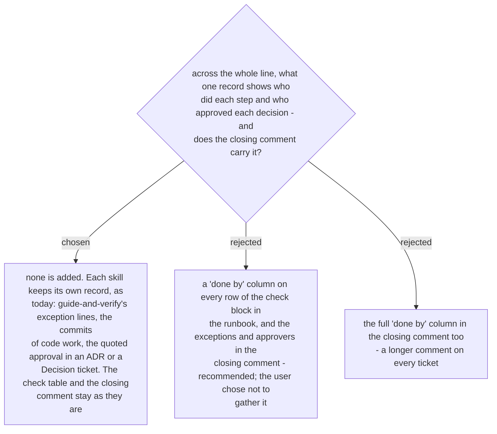

# Who did a step stays in each skill's own record, and the check gathers none of it

Ruled 2026-11-18 by the user (Pon), on Decision ticket `who-did-what` of the map
`docs/decision-map/one-entry-for-a-ticket/`: "C. ไม่รวม", from three options the agent laid
out. The user gave no reason; the agent recommended the first rejected branch.

Where a reader finds it today, unchanged:

| what | where |
|---|---|
| a step the agent made at the person's request | `guide-and-verify`'s exception line: who asked, which path, the result, the time |
| code the agent wrote | the commits, and the plan the person agreed to |
| who approved a decision | the ADR or Decision ticket, in the person's quoted words |
| where a pass's proof came from | the check's mark: `cited`, `measured` or `told` (ADR 0320) |

Nothing changes in `resolve-the-ticket/SKILL.md` for this decision.
