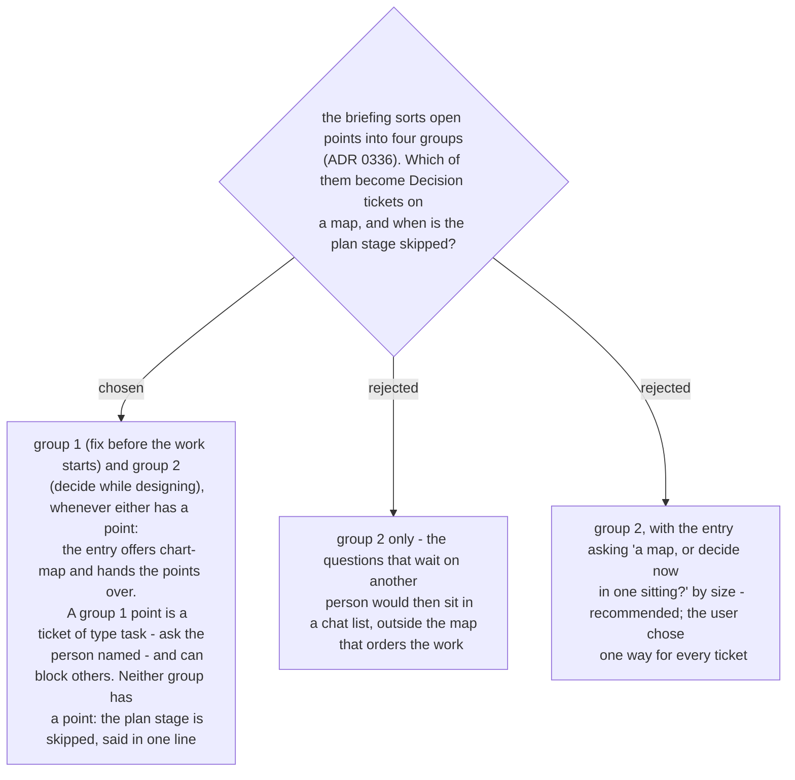

# The plan stage puts every open point of groups one and two on a Decision map

Ruled 2026-11-18 by the user (Pon), on Decision ticket `map-trigger` of the map
`docs/decision-map/one-entry-for-a-ticket/`: "B. กลุ่ม 1 + 2", from three options the agent
laid out. The agent recommended the last rejected branch.

| briefing group | on the map as |
|---|---|
| 1. fix before the work starts | a `task` ticket: the question, who must answer (or `not named`), and what it blocks |
| 2. decide while designing | a `grilling` ticket |
| 3. rules to keep | not a ticket - a line in the map's notes at most |
| 4. touches no task | not a ticket |

The dependency map the briefing already draws ("what depends on what") is what the blocking
edges are read from.

Known, and not changed here: `chart-map` stops by its own rule when it finds no fog and the
work fits one session, and points at `grill-then-plan`. It may not be edited (ADR 0338), so
on a small ticket the person will see that stop. The entry loads `chart-map` only on the
person's yes (ADR 0339).

**Not yet in the skill.** It lands when the map's `plan-with-map` milestone is built.
