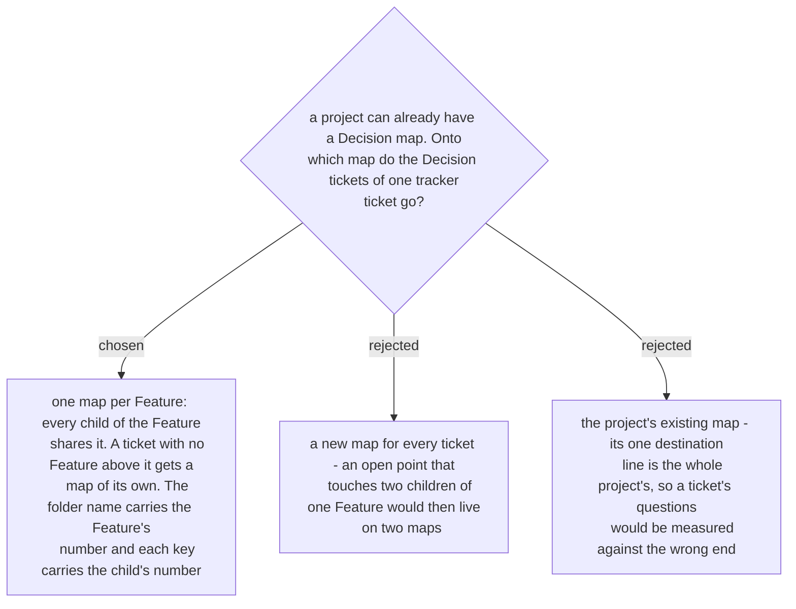

# A ticket's decisions go on one map per Feature

Ruled 2026-11-18 by the user (Pon), on Decision ticket `which-map` of the map
`docs/decision-map/one-entry-for-a-ticket/`: "C. map ต่อ Feature", from three options the
agent laid out.

The naming below is the agent's proposal, shown to the user only as examples; it follows
how runbooks are already named and found (`runbook-ado-151-…`, matched by whole number):

| thing | name | example |
|---|---|---|
| the map's folder | `<tracker>-<Feature id>-<short name>` | `docs/decision-map/ado-193-creditor-sync/` |
| a Decision ticket's key | `<child id>-<short name>` | `195-shared-table` |
| a point that touches several children | the key of the first child; the question names every ticket it touches | `195-shared-table`, question names #195 and #196 |
| a ticket with no Feature above it | its own id in the folder name | `docs/decision-map/ado-151-overdue-report/` |

The entry skill finds the map the way it finds a runbook: by the number, matched whole.
`chart-map` needs no change for this - on a map that exists it skips the destination and
only adds (its re-chart entry).

This answers half of the map's open fog line ("a Feature with several child tickets"): the
decisions of a family are kept together. How the *stages* walk a family - one run per
child or one for all - is still not specified.

**In the skill since dev-workflows 0.66.0** (`plugins/dev-workflows/skills/resolve-the-ticket/SKILL.md`).
