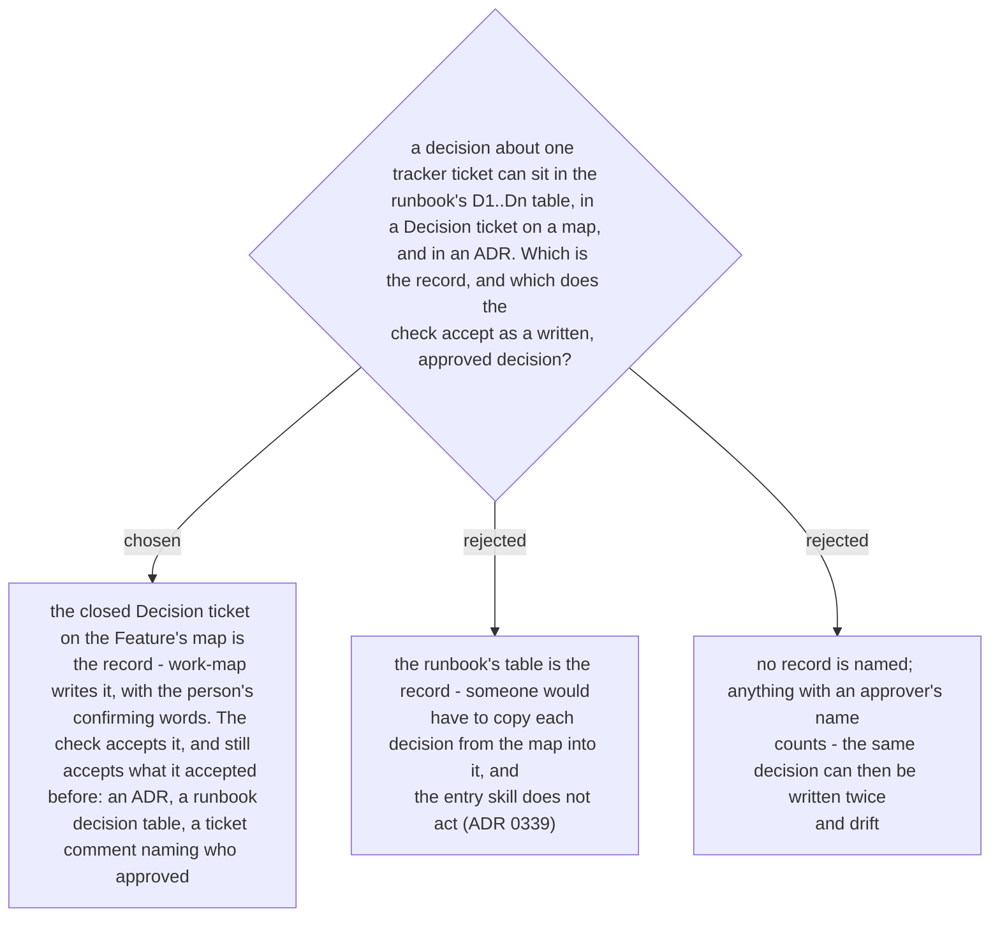

# A closed Decision ticket on the Feature's map is the record of a ticket's decision

Ruled 2026-11-18 by the user (Pon), on Decision ticket `decision-store` of the map
`docs/decision-map/one-entry-for-a-ticket/`: "A. Decision ticket บน map", from three options
the agent laid out.

| place | role |
|---|---|
| closed Decision ticket on the Feature's map (ADR 0346) | the record of a decision about one tracker ticket |
| ADR | the canonical text where `work-map` produced one; the Decision ticket links to it |
| runbook's D1..Dn table | not written for new work; one that exists is still accepted - no runbook is converted |
| tracker comment naming who approved | still accepted |

This widens [ADR 0324](workflow-daily-work-0324-a-difference-from-the-ticket-passes-only-under-a-written-decision.md):
`pass - differs by decision <id>` may now cite a Decision ticket by its key and path. An
**open** or **claimed** Decision ticket is not a decision; only a closed one counts.

**In the skill since dev-workflows 0.66.0** (`plugins/dev-workflows/skills/resolve-the-ticket/SKILL.md`).
