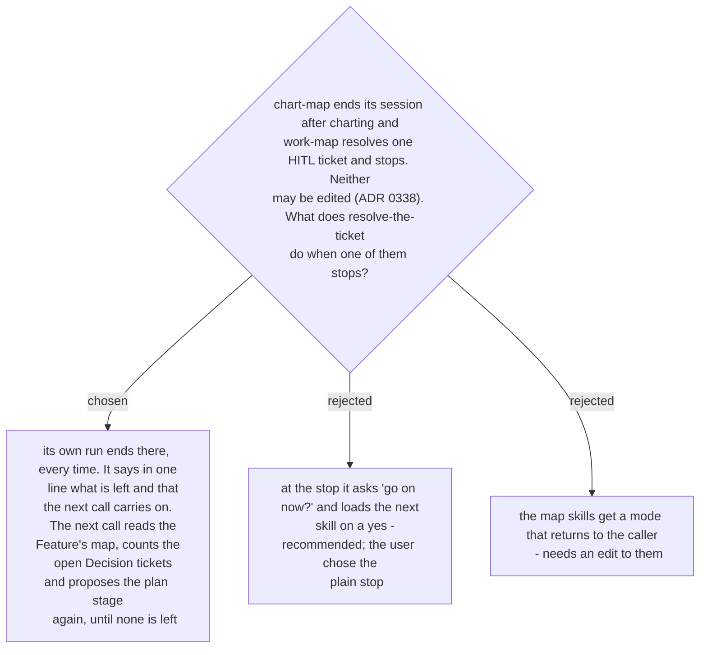

# The entry's run ends wherever a map skill stops

Ruled 2026-11-18 by the user (Pon), on Decision ticket `one-session-stop` of the map
`docs/decision-map/one-entry-for-a-ticket/`: "A. จบรอบเสมอ", from two options the agent laid
out. The agent recommended the first rejected branch.

One call, in the plan stage, does one of these and then ends:

| the Feature's map | the call |
|---|---|
| does not exist, and groups 1 or 2 have points (ADR 0345) | loads `chart-map`; the map is charted; the run ends |
| has open Decision tickets | loads `work-map`; one ticket is resolved; the run ends |
| has none left open | the plan stage is over; the entry proposes do and verify |

How the next call knows: it reads the map the way it reads the runbook
([ADR 0337](workflow-daily-work-0337-resolve-the-ticket-walks-four-stages-and-reads-the-runbook-to-know-which-comes-next.md)) -
the count of open Decision tickets is the plan stage's evidence line.

**In the skill since dev-workflows 0.66.0** (`plugins/dev-workflows/skills/resolve-the-ticket/SKILL.md`).
