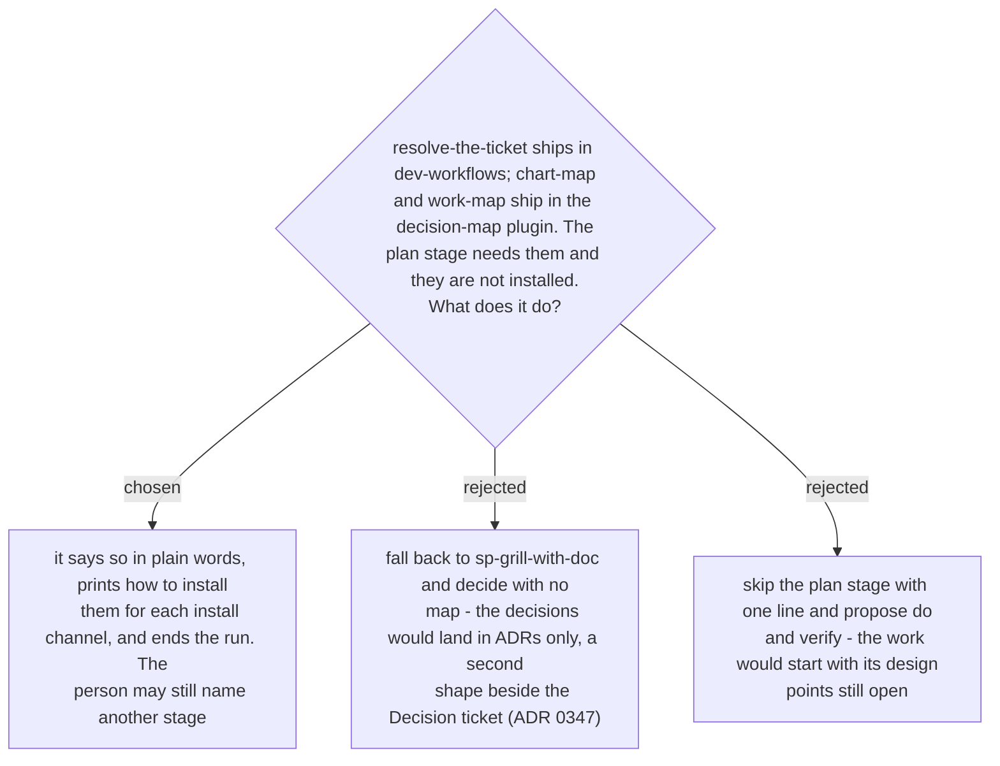

# With the map skills not installed, the plan stage stops with the install line

Ruled 2026-11-18 by the user (Pon), on Decision ticket `plugin-missing` of the map
`docs/decision-map/one-entry-for-a-ticket/`: "A. หยุดพร้อมคำสั่งติดตั้ง", from three options
the agent laid out.

What the research ticket `cross-plugin-loading` found, and what follows from it here (the
agent's reading, not a separate answer from the user):

- **How "not installed" is told:** by whether the skills are available in the session
  (the way ADR 0046 does it), not by a plugin prefix.
- **How the skills are named:** in the short form - `chart-map`, `work-map` - loaded
  through the harness's mechanism (ADRs 0071, 0072). A plugin-prefixed name does not
  resolve in the flat installs.
- **The install line covers three channels.** Claude Code: the `decision-map` plugin from
  this marketplace. The npx skills channel: the two skills by name. Antigravity: the
  `decision-map` plugin ships no installer today, so the line says exactly that and names
  the two skill folders to copy - it must not point at a file that does not exist, as
  `/daily`'s fallback does for `ado-backlog`.
- **Only the plan stage needs them.** Briefing, do and verify, and the check run without
  the `decision-map` plugin.

Not measured: no install channel has a live test on record of one skill loading another
plugin's skill by name. The first real run of the plan stage is that test.

**Not yet in the skill.** It lands when the map's `plan-with-map` milestone is built.
