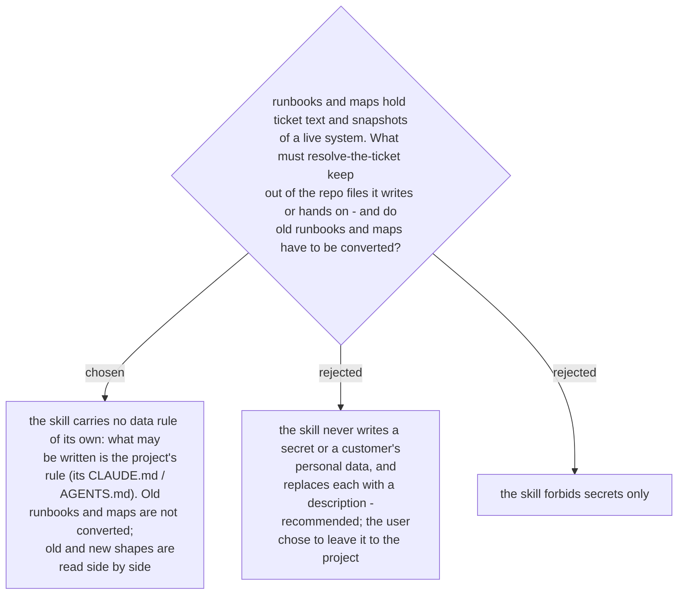

# resolve-the-ticket carries no data rule of its own, and converts no old file

Ruled 2026-11-18 by the user (Pon), on Decision ticket `repo-data-rules` of the map
`docs/decision-map/one-entry-for-a-ticket/`: "C. ไม่มีกฎในสกิล", from three options the agent
laid out. The agent recommended the first rejected branch. The user gave no reason.

What still holds, from elsewhere:

- The skill follows the project's `CLAUDE.md` / `AGENTS.md`, as it already does for a
  comment format or a flowchart shape.
- What a loaded skill writes - a snapshot taken by `guide-and-verify`, a ticket created by
  `chart-map` - is that skill's own matter; none of them may be edited (ADR 0338).

No conversion (the agent's reading of earlier answers, stated to the user before the
question): a runbook with a D1..Dn table is still accepted (ADR 0347); a runbook with no
stage trace line is still read by its steps and results (ADR 0337, ADR 0343).

Nothing changes in `resolve-the-ticket/SKILL.md` for this decision.
