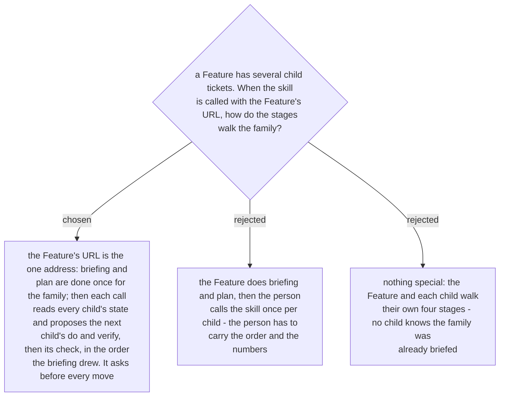

# Called with a Feature, resolve-the-ticket walks its children one at a time

Ruled 2026-11-18 by the user (Pon), on Decision ticket `family-walk` of the map
`docs/decision-map/one-entry-for-a-ticket/`: "B. แม่พาเดินลูกเอง", from three options the
agent laid out. The ticket was the map's last fog line, graduated the same day.

| stage | for a Feature with children |
|---|---|
| briefing | once, for the family (the skill reads the Feature and every child in full already) |
| plan | once, on the Feature's map ([ADR 0346](workflow-daily-work-0346-a-tickets-decisions-go-on-one-map-per-feature.md)) |
| do and verify | per child, one at a time, in the order of the briefing's "what depends on what" map |
| check | per child; then the Feature's own check |

- Each call names the child it proposes and why ("#195: its points are closed, nothing
  waits on it"), and asks once (ADR 0337). The person may name another child or another
  stage.
- A child's state is read from its own runbook, as for any ticket (ADRs 0337, 0343).
- The person may still call the skill with a child's URL. It then sees the family's
  briefing and plan are done and proposes that child's do and verify.
- **The Feature's own check is unchanged:** a row per child with its State; a child's
  criteria get that child's own check
  ([ADR 0321](workflow-daily-work-0321-an-open-child-keeps-the-parent-not-ready-and-a-childs-own-criteria-get-their-own-run.md)).

The last three points are the agent's reading, said to the user with the options; the
user's answer was the choice of the walk.

**Not yet in the skill.** It lands when the map's `do-and-verify` milestone is built.
