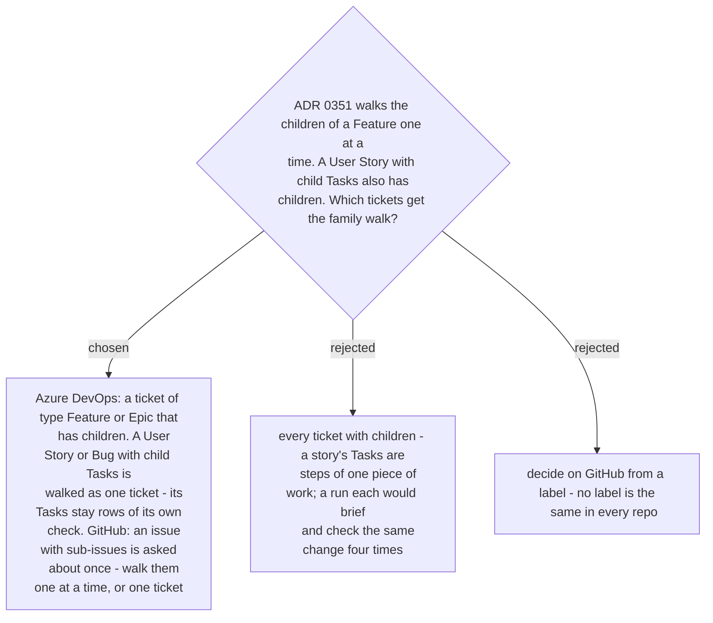

# The family walk is for a Feature or an Epic, and is asked about on GitHub

Ruled 2026-11-18 by the controller while writing the implementation plan
(`docs/superpowers/plans/2026-11-18-resolve-the-ticket-one-entry.md`). ADR 0351 names "a
Feature with several child tickets" and its example is Feature #193 with stories #194-#197;
the existing check already treats a story's child Task as one row (ADR 0321, eval 0). This
ADR only draws the line between the two. The user has not ruled on it; it is the agent's
reading and is flagged to the user with the plan.
