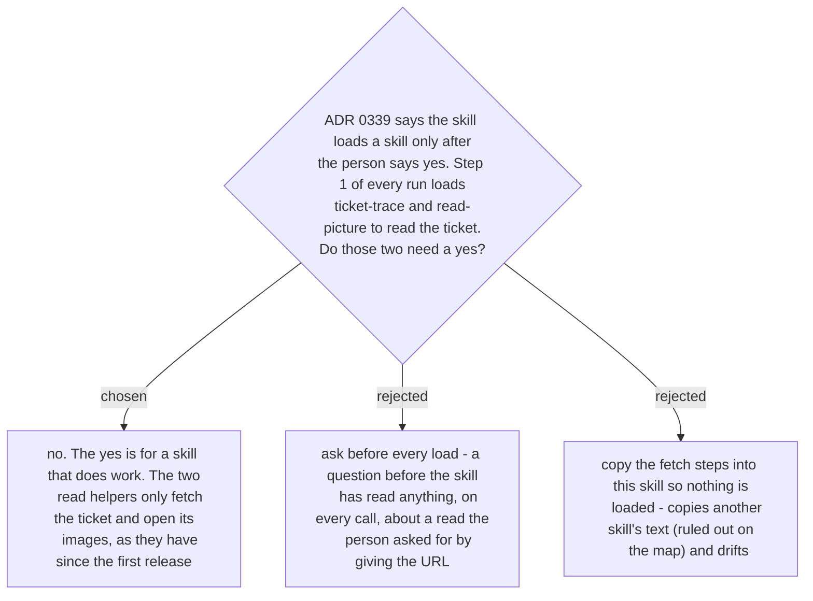

# The read helpers are loaded without a yes

Ruled 2026-11-18 by the controller during execution of
`docs/superpowers/plans/2026-11-18-resolve-the-ticket-one-entry.md`, after a task review
found the new line "never loads a skill without a yes" contradicted step 1. It reads
ADR 0339's "nothing more than today" as covering the two read helpers. The user has not
ruled on it; it is flagged to the user with the finished branch.
