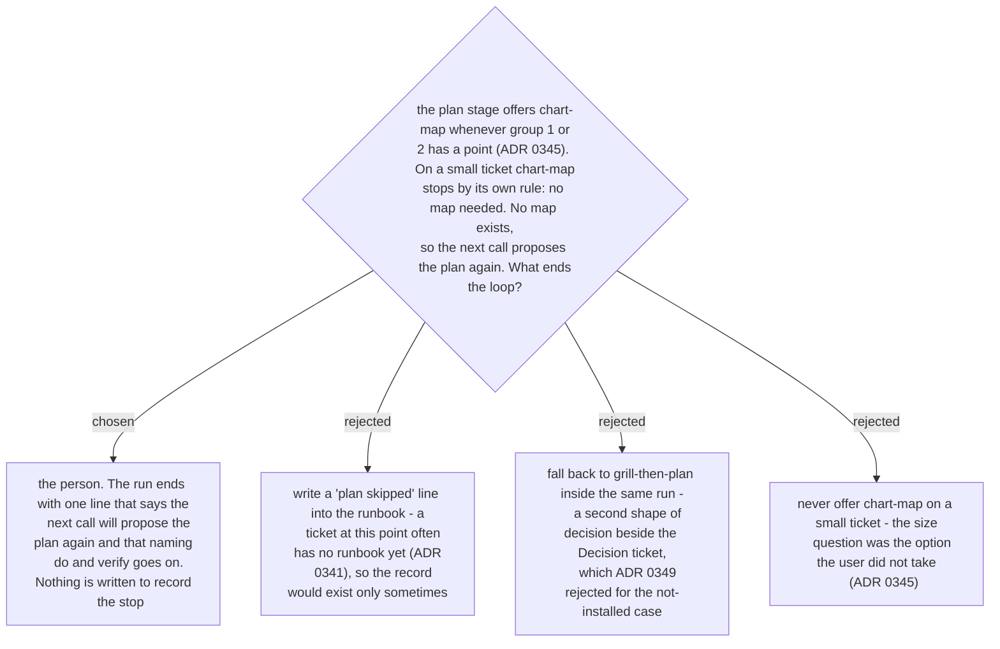

# When chart-map says no map is needed, the person names the next stage

Ruled 2026-11-18 by the controller during execution of
`docs/superpowers/plans/2026-11-18-resolve-the-ticket-one-entry.md`, after the final
whole-branch review walked this case and found the loop. ADR 0345 names the stop as known
and leaves the next call open; this is the smallest rule that closes it without a new
write and without editing `chart-map` (ADR 0338). The user has not ruled on it; it is
flagged to the user with the finished branch as the weakest of the three rulings.
