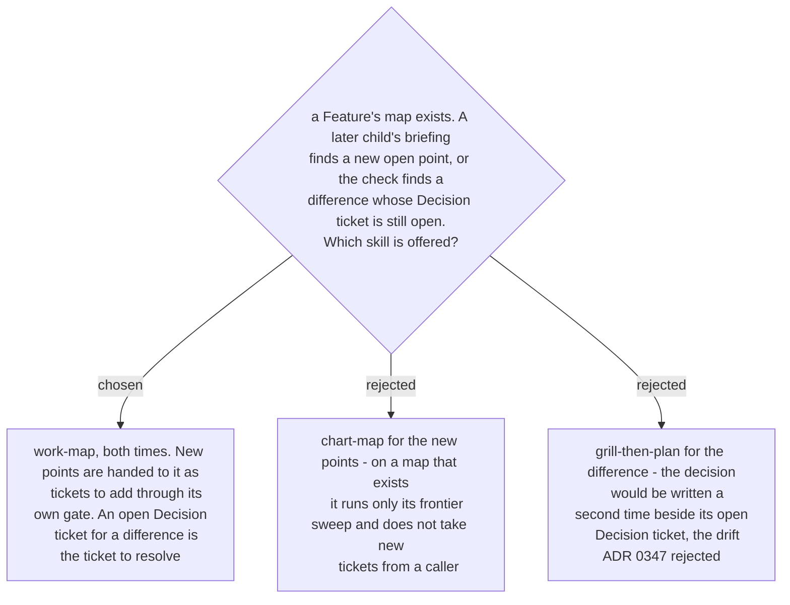

# Once a map exists, work-map is the door for new points and for an open difference

Ruled 2026-11-18 by the controller during execution of
`docs/superpowers/plans/2026-11-18-resolve-the-ticket-one-entry.md`, after the final
whole-branch review found that ADR 0346's "chart-map only adds" does not match
`chart-map`'s re-chart entry, and that the check's differs gap ignored an open Decision
ticket. `work-map` already adds tickets through an additive gate and resolves one ticket
per session; neither skill is edited (ADR 0338). The user has not ruled on it; it is
flagged to the user with the finished branch.

Not measured: whether `work-map` takes a caller's list of new tickets without the person
restating them. The first real run is the test.
