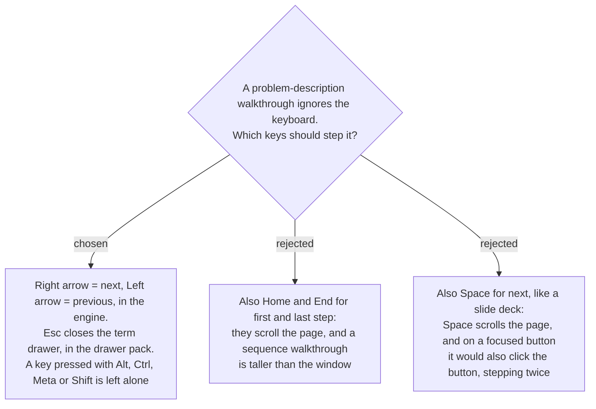

# The walkthrough engine steps on the left and right arrow keys only

The engine bound only the `onclick` of its three buttons; no file in the skill had a
`keydown` listener, so the arrow keys never did anything (measured 2026-11-21: zero matches
for `keydown`, `ArrowLeft` or `ArrowRight` in the three skill copies and in a published
walkthrough). The engine now listens for `keydown` on `document`: the Right arrow does what
the Next button does and the Left arrow does what the Previous button does. The listener is
in the engine because the engine owns navigation (ADR 0020), so every mode gets it and no
mode pack changes.

The listener does nothing when Alt, Ctrl, Meta or Shift is held, so Alt+Left still goes back
in the browser and Shift+arrow still extends a text selection. It does nothing when the
event comes from an input, a textarea, a select or an editable element, so a mocked form
field keeps its own arrow keys.

Esc closes the term drawer. That listener is in `term-drilldown.html`, not in the engine:
the engine does not know the drawer exists (ADR 0019), and a walkthrough assembled without
the drawer has nothing for Esc to close.
