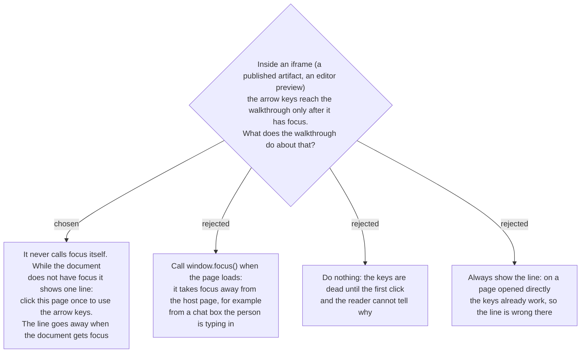

# An embedded walkthrough never takes focus, and says when a click is needed

A key event goes to the document that has focus. A walkthrough opened directly in a browser
has focus from the start. A walkthrough shown inside an iframe does not: the host page has
it until the reader clicks inside the frame. The engine therefore shows a hint line next to
the controls when `document.hasFocus()` is false, and hides it on the window's `focus`
event and shows it again on `blur`. The hint is engine chrome, like the step badge; no
scene sets it.

Where the hint sits and how it is hidden changed in ADR 0381: it has a row of its own
under the buttons and turns invisible, so nothing moves when the page gets focus.

The engine does not call `window.focus()`. A page that takes focus when it loads, or when
the host reloads it, moves the caret out of whatever the person was typing in.
