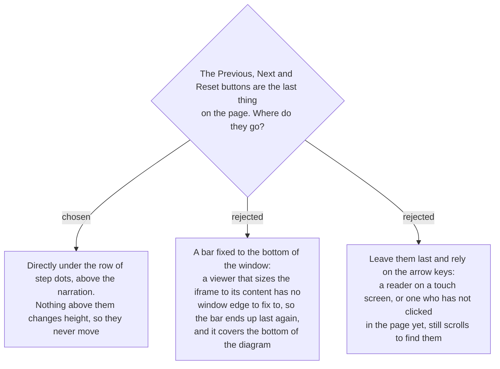

# The walkthrough controls sit above the narration

The engine's §HTML put the controls after the mode content. On a tall mode content the
reader scrolls past it to reach them: the sequence diagram of the walkthrough published on 2026-11-20 is
664 units high. The controls also moved between steps, because the panels beside or under
the diagram differ in height, so a reader pressing Next again had to find the button first.

The order of the engine shell is now: title, step dots, controls with the keyboard hint
(ADR 0357), narration, mode content. Everything above the controls has a fixed height, so
the buttons stay where the pointer is. This changes the page for every mode, because the
controls are part of the engine (ADR 0020).
