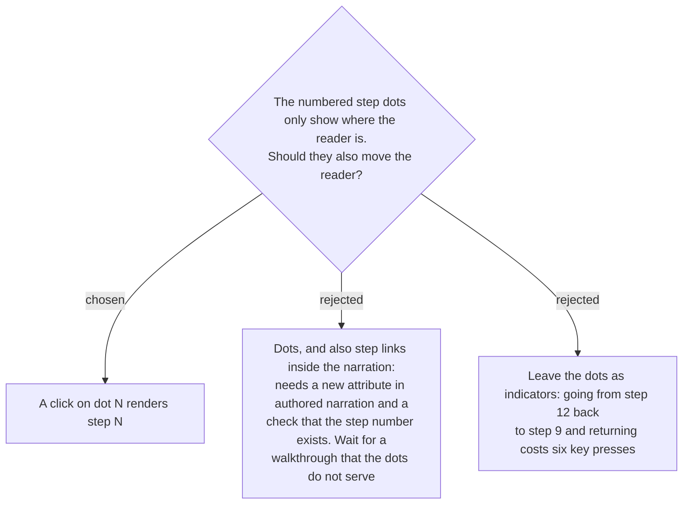

# A click on a step dot goes to that step

A narration sometimes sends the reader back ("look again at check 2 in the activity diagram,
step 9"). With only Previous and Next that is three presses back and three forward. A click
on a dot now sets the current step to that dot's number and renders it.

Jumping is safe because every scene describes the whole page state and the engine clears the
mode before it runs a scene; no scene depends on the scene before it having run. The dots
are built by the engine, so every mode gets this and no mode pack changes.
