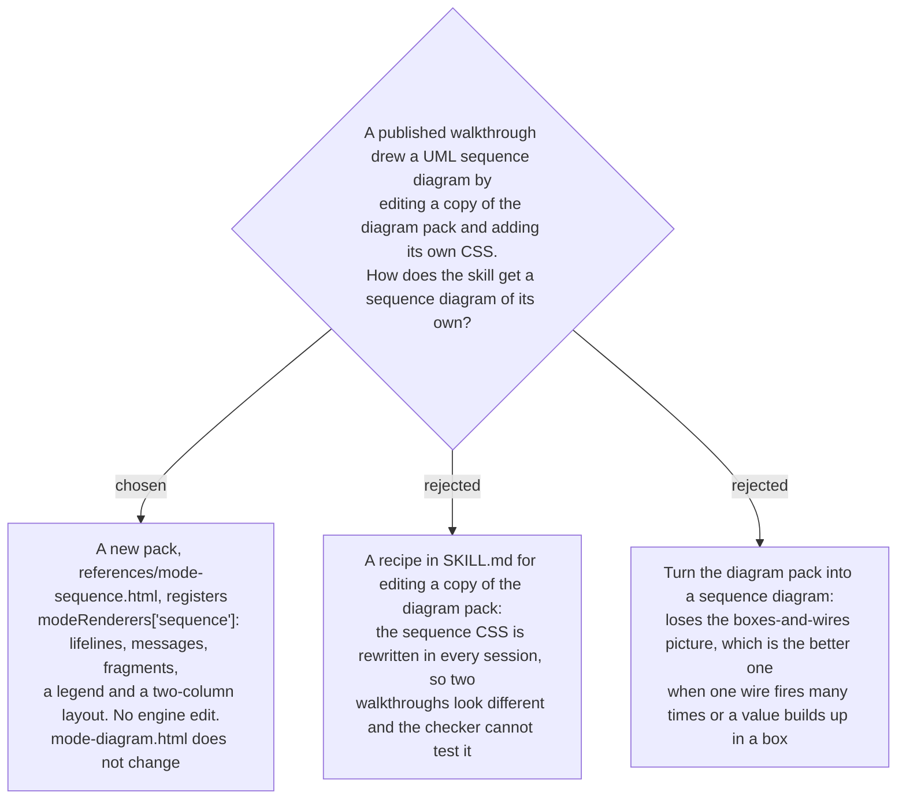

# Sequence is a fourth mode pack, and the diagram pack stays as it is

The walkthrough published on 2026-11-20 is the evidence that a sequence diagram
explains a flow well: five lifelines, eleven numbered messages, an `opt` frame around the
proposed part, one message lit per step. None of it is in the skill. That session wrote
about sixty lines of `.seq-*` and `.uml-*` CSS on top of a copy of `mode-diagram.html`, so
the next session cannot reproduce it and `check-walkthrough.py` knows nothing about it.

The sequence diagram becomes a mode pack of its own, the fourth. Adding it is the case
ADR 0020 was built for: one file that registers one renderer, and zero engine edits. ADR
0023 asked whether a time-ordered mode would need a layout hook in the engine. It does not:
the published walkthrough ran on the unmodified engine, because every lifeline and message
position is authored markup and every state is a class on an element declared up front.

The diagram pack is not changed and not renamed. It remains the mode for a flow where the
wiring is the story.
