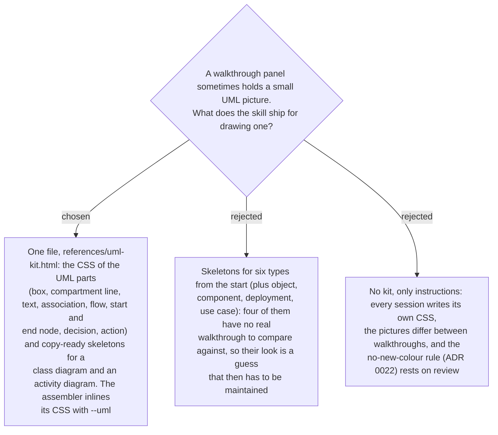

# Supporting diagrams are drawn from one UML kit, which ships class and activity skeletons

The walkthrough published on 2026-11-20 used three small UML pictures in its panels: two class
diagrams and one activity diagram. Their `.uml-*` CSS was written in that session. It moves
into one reference file, in the same pattern as the term drawer (ADR 0019): a single source
that the assembler inlines when the walkthrough uses it. The kit's CSS uses only the
engine's `:root` tokens and the engine's five markerheads.

The kit ships skeletons for the two types that a real walkthrough has proved. Another UML
type is drawn from the same parts. Its skeleton is added to the kit when a second
walkthrough needs that type, not before.

`check-walkthrough.py` fails a walkthrough that uses a kit class without the kit's CSS, and
one assembled with `--uml` that draws nothing from the kit. These are the same two checks
the drawer has.
