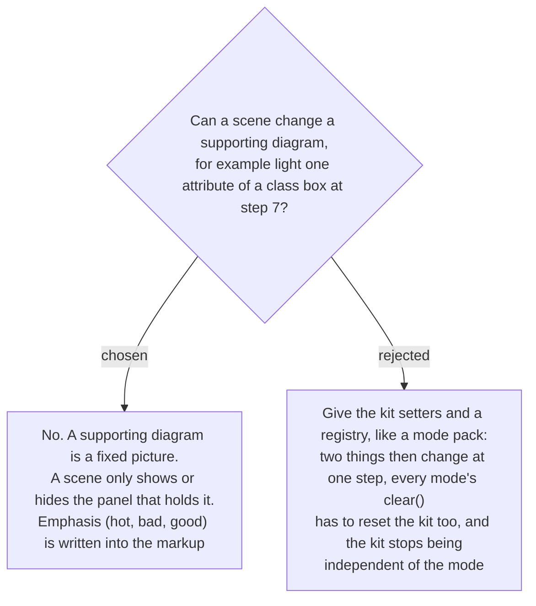

# A supporting diagram has no states

A step changes one thing, and that thing is on the main diagram. If a supporting diagram
also changed, the reader would have two places to watch. The kit therefore has no renderer,
no registry and no setters. A class box that must look different at a later step is a
second panel with a second picture.

This keeps the kit independent of the mode pack: every mode's `clear()` already hides every
`.wt-panel`, and that is all a supporting diagram needs.
